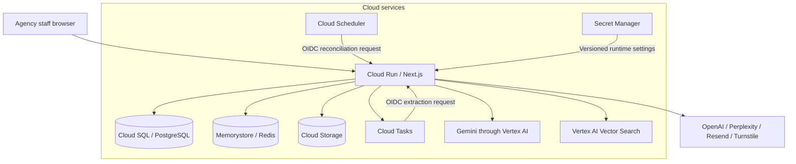

# Vidicy

AI document review for visa agencies.

Visa agency staff must compare documents with a route's requirements, find missing or conflicting evidence, and track corrections across replacement files. A complete set of uploads can still contain an expired document, a name mismatch, or evidence that needs clarification.

Vidicy connects these tasks through a staged, multimodal review pipeline and a shared case workspace. Route research becomes a structured checklist. Extracted text, retrieved document context, and images feed individual document assessments, deterministic consistency checks, and a combined Gemini review. Borderline scores trigger a second assessment against the same evidence and scoring rules.

The engineering connects model execution to durable application state: bounded parallel calls, deadline-aware retries, document snapshots, atomic review publication, and recoverable report delivery. Staff inspect the evidence, control issue decisions, and run review again after corrections. Staff retain responsibility for submission decisions.

The workflow helps staff reduce repeated document checking and give clients a clear list of corrections.

The application is in `apps/agency`. It runs on Next.js, Cloud Run, and PostgreSQL. The review pipeline uses Gemini through Vertex AI, with other providers for specific research, structuring, translation, and embedding tasks.

This README is the entry point for developers and technical reviewers. The [technical reference](apps/agency/README.md) covers service contracts, identities, failure handling, recovery, and deployment configuration.

## Contents

- [Agency workflow](#agency-workflow)
- [Engineering design](#engineering-design)
- [Technology and services](#technology-and-services)
- [System architecture](#system-architecture)
- [AI configuration](#ai-configuration)
- [Runtime configuration](#runtime-configuration)
- [Commands](#commands)
- [Deployment](#deployment)
- [Technical documentation](#technical-documentation)
- [Code map](#code-map)

## Agency workflow

1. Create a case with the applicant, destination, visa type, and travel details.
2. Generate a document checklist for that case.
3. Upload PDFs or images and assign each file to a checklist requirement.
4. Extract document content and run an AI evaluation.
5. Review the findings. Resolve or dismiss tracked issues and check case readiness.
6. Replace or correct documents when needed. Document changes invalidate affected evaluations and reports.

The case workspace links document findings to their available source files and places document preview, requirements, issue decisions, notes, and activity together. Priority, status, search, and selected evidence use URL state so a review can survive navigation and reloads. The dashboard derives the next action from missing files, review validity, assignments, and open issues. See the [workspace](apps/agency/src/components/agency/agency-case-workspace.tsx), [source selection rules](apps/agency/src/lib/agency-review-workspace.ts), and [work queue](apps/agency/src/lib/agency-dashboard-queue.ts).

Review continues into a private client report with HTML download, print/PDF controls, and email handoff. Delivery preserves the complete provider request and an idempotency key across retries. [Browser regression tests](apps/agency/tests/report-workflow.pw.ts) exercise review, report handoff, access checks, recovery states, and narrow layouts using private PostgreSQL and Redis with provider stubs.

### From files to review findings

| Stage                      | Implemented behavior                                                                                                              | Purpose in the agency workflow                                             |
| -------------------------- | --------------------------------------------------------------------------------------------------------------------------------- | -------------------------------------------------------------------------- |
| Checklist research         | Perplexity is asked for official requirements for the visa route; OpenAI structures the result with applicant context             | Turn research into required and optional document tasks                    |
| Evidence preparation       | Native PDF extraction, Gemini extraction, and enabled OpenAI fallback produce stored text; supported files can also supply images | Make PDF and image evidence available to review                            |
| Individual document review | Gemini checks each requirement against available text, relevant retrieved chunks, and images                                      | Produce document-level feedback, extracted fields, and confidence          |
| Combined case review       | Code checks extracted names and expiry dates; Gemini combines document findings and missing requirements                          | Identify concerns across the case rather than score each file in isolation |
| Borderline assessment      | A second Gemini call uses a skeptical prompt near the configured readiness threshold                                              | Record score disagreement for reviewer attention                           |
| Correction loop            | Findings become tracked issues; replacement files invalidate affected review and report state                                     | Keep the review tied to the evidence that staff will submit                |

The design combines generated analysis with explicit workflow rules. A high score cannot bypass a missing required file or an open issue when the server checks submission readiness. Conditional updates protect newer human decisions during synchronization. The [review pipeline](apps/agency/README.md#review-pipeline) explains the stages, fallback behavior, and source evidence.

For example, a replacement passport can correct an expiry issue while a name mismatch with another document still needs review. Vidicy invalidates the previous assessment, checks the current uploads, and keeps the remaining concern as an issue for staff.

Review requests create durable jobs. Staff can leave the page and return to the saved queue or running state. Authenticated task workers load current evidence and publish the review and job completion together. A shared Redis limit bounds Gemini extraction and review calls across cases and service instances.

## Engineering design

| Mechanism                     | Completed implementation                                                                                                                                                                                                              | Evidence                                                                                                                                                                                |
| ----------------------------- | ------------------------------------------------------------------------------------------------------------------------------------------------------------------------------------------------------------------------------------- | --------------------------------------------------------------------------------------------------------------------------------------------------------------------------------------- |
| Shared production review core | The application, quality harness, and benchmark execute the same Gemini prompts, schemas, document checks, combined assessment, and conditional second pass.                                                                          | [Review core](apps/agency/src/services/case-evaluation.ts), [core tests](apps/agency/src/__tests__/case-evaluation.test.ts)                                                             |
| Consistent review state       | Required model stages must finish before publication. A transaction saves the evaluation, issues, scores, and report state together. Snapshot checks reject corrected evidence; conditional updates protect newer reviewer decisions. | [Publication](apps/agency/src/server/agency-review.ts), [database workflow tests](apps/agency/src/__tests__/agency-review.test.ts)                                                      |
| Durable review execution      | PostgreSQL allows one active review job per applicant. Authenticated task delivery, expiring worker claims, bounded recovery, and atomic job completion keep work recoverable after a process stops. An expired worker cannot publish over its replacement. | [Review jobs](apps/agency/src/server/review-jobs.ts), [process recovery tests](apps/agency/src/__tests__/review-jobs.test.ts), [task delivery tests](apps/agency/src/__tests__/review-tasks.test.ts) |
| Shared inference capacity     | A Redis Lua operation reserves Gemini capacity across cases and service instances. Expiring leases recover abandoned slots; owner tokens protect other calls. HTTP 429 sets a shared cooldown. Each model stage retains its deadline while waiting for capacity. | [Capacity control](apps/agency/src/infra/google/gemini-capacity.ts), [Redis integration tests](apps/agency/src/__tests__/gemini-capacity.integration.test.ts), [model adapter](apps/agency/src/lib/gemini-evaluation.ts) |
| Input-bound feedback reuse    | A versioned SHA-256 key covers the model request, full source text, and translation. Changes to requirements, case context, prompts, or evidence trigger a fresh document assessment; reused structured findings still enter the combined review. | [Cache key](apps/agency/src/services/case-evaluation.ts), [cache regression tests](apps/agency/src/__tests__/case-evaluation.test.ts) |
| Inspectable processing runs   | The upload-to-report harness exercises extraction, indexing, retrieval, queued review, SQL publication, and report download with private test databases. It records stage times, failed attempts, token usage, and implementation/input hashes; simulated and live-provider runs are identified separately. | [Workflow benchmark](apps/agency/src/__tests__/eval/workflow-benchmark.test.ts), [measurement contracts](apps/agency/README.md#upload-to-report-measurements) |
| Recoverable client handoff    | A short SQL transaction claims a send and saves the complete request. The provider call runs outside the transaction. Retries reuse the saved request and key; concurrent sends and stale reports are rejected.                       | [Report delivery](apps/agency/src/server/client-reports.ts), [delivery tests](apps/agency/src/__tests__/client-report-delivery.test.ts)                                                 |

Quality checks include a complete reference case and controlled variants with one changed document. Recovery tests stop a separate worker process during a review, then verify that a new worker can complete the saved job after its claim expires. Private PostgreSQL tests check rollback and stale-worker rejection; private Redis tests check shared capacity and recovery of expired slots. Benchmarks retain failures and record implementation/input hashes alongside concurrency, latency percentiles, and token-based cost estimates. The [technical reference](apps/agency/README.md#engineering-contracts) connects these mechanisms to their tests and measurement boundaries.

## Technology and services

| Area                                      | Current implementation                                                  |
| ----------------------------------------- | ----------------------------------------------------------------------- |
| Web application                           | Next.js 16.1.6, React 19, TypeScript, App Router                        |
| Interface                                 | Tailwind CSS 4, Radix UI components, Zustand, nuqs                      |
| Application hosting                       | Cloud Run with a standalone Next.js container                           |
| Database                                  | Cloud SQL for PostgreSQL, `pg`, and Drizzle ORM                         |
| Documents and screenshots                 | Cloud Storage                                                           |
| Sessions, tokens, rate limits, and caches | Redis through the Memorystore adapter                                   |
| Document context search                   | Vertex AI Vector Search                                                 |
| Document processing jobs                  | Cloud Tasks with authenticated internal HTTP routes                     |
| Recovery jobs                             | An internal document reconciliation route for Cloud Scheduler           |
| Authentication                            | Email/password and Google OAuth; sessions stored in Redis               |
| Email                                     | Resend and React Email templates                                        |
| CAPTCHA                                   | Cloudflare Turnstile, when enabled                                      |
| Error reporting                           | Sentry for Node.js                                                      |
| Runtime secrets                           | Secret Manager references injected into Cloud Run                       |
| Build and release                         | GitHub Actions, Cloud Build, and Artifact Registry                      |
| Operations                                | Cloud Logging for platform/build logs; application JSON logs and Sentry |

## System architecture



### Data and request flow

The server checks the user's session and case permission before accepting a document. It writes the file to Cloud Storage, commits its database record and checklist/review changes, then awaits Cloud Tasks acceptance before returning upload success.

Cloud Tasks calls an authenticated internal route on the same service. The route acquires a PostgreSQL lock for the document, extracts content, and indexes document chunks. Cloud Scheduler identifies old or failed work and reserves bounded recovery attempts. PostgreSQL remains authoritative for document identity and case state; vector results are checked against it before use.

Each service has an explicit state boundary. Queue acceptance confirms delivery scheduling, document locks control active processing, and reconciliation finds stored work that needs another attempt. The [sequence diagram](apps/agency/README.md#system-boundaries) shows this flow.

Within PostgreSQL, case creation commits client changes, the case, and its primary applicant together. Review publication commits the evaluation, tracked findings, scores, and report state together. Failed writes roll back their group. A late failed extraction cannot erase text saved by a successful attempt. See the [transaction and review contracts](apps/agency/README.md#transactions-and-locks).

### Why the services fit this implementation

| Service                     | Role in this code                                                          | Design mechanism                                               |
| --------------------------- | -------------------------------------------------------------------------- | -------------------------------------------------------------- |
| Cloud Run and Cloud Tasks   | Serve the application and deliver document jobs outside the upload request | Named tasks, authenticated delivery, and bounded recovery      |
| Cloud SQL                   | Store case state and coordinate concurrent work                            | Transactions, document locks, and conditional issue updates    |
| Cloud Storage               | Store source files and larger vector metadata                              | Generation-pinned reads and content-addressed metadata         |
| Memorystore                 | Supply sessions, tokens, route research caches, and counters               | Atomic token consumption, expiry, and fixed rate-limit windows |
| Vertex AI and Vector Search | Extract and evaluate evidence; retrieve relevant document context          | Structured model output and database-checked retrieval         |

The implementation reuses stored extraction, completed indexes, matching per-document feedback, and cached route research. Document assessments run with bounded concurrency within the review request, followed by the combined assessment. The [measurement tools](apps/agency/README.md#repeatable-review-measurements) record latency, token usage, failures, and token-based cost estimates for the shared review core.

See the [service reference](apps/agency/README.md#cloud-run) for implementation details and source links.

## AI configuration

These are the model IDs requested by the checked-in code. The project must have access to the configured models and services.

| Task                            | Provider and configured model                           |
| ------------------------------- | ------------------------------------------------------- |
| Document extraction             | Vertex AI: `gemini-3.8-flash`                           |
| Document evaluation             | Vertex AI: `gemini-3.8-flash`                           |
| Checklist research              | Perplexity: `sonar-pro`                                 |
| Structured checklist generation | OpenAI: `gpt-4o`                                        |
| Document embeddings             | OpenAI: `text-embedding-3-small`, with 1,536 dimensions |
| Evaluation translation          | OpenAI: `gpt-4.1-mini`                                  |

PDF extraction first tries native text extraction. It then tries Gemini when needed. OpenAI extraction fallback uses `gpt-4.1`, then `gpt-4.1-mini`.

`GEMINI_DOCUMENT_EXTRACTION=false` disables Gemini extraction. `OPENAI_DOCUMENT_EXTRACTION_FALLBACK=false` disables the OpenAI extraction fallback. Both paths are enabled by default outside tests. Document evaluation uses Vertex AI and does not switch to OpenAI when the provider fails.

Model constants are in [gemini.ts](apps/agency/src/lib/gemini.ts). Extraction is in [pdf-parser.ts](apps/agency/src/services/pdf-parser.ts). Evaluation is in [gemini-evaluation.ts](apps/agency/src/lib/gemini-evaluation.ts).

## Runtime configuration

The application requires PostgreSQL, Redis, Cloud Storage, Vertex AI, and Cloud Tasks. Provision these services and grant the Cloud Run service identity the required access before deployment.

Configure the service with `NEXT_PUBLIC_SITE_URL`, `GOOGLE_CLOUD_PROJECT`, `GOOGLE_CLOUD_LOCATION`, `GOOGLE_CLOUD_REGION`, and `GCS_DOCUMENT_BUCKET`. Set `DATABASE_URL` or the standard `PGHOST`, `PGPORT`, `PGDATABASE`, `PGUSER`, and `PGPASSWORD` variables for PostgreSQL, and `REDIS_URL` for Redis. Cloud Run can use a Cloud SQL socket path in `PGHOST`.

The cloud service adapters use Application Default Credentials from the Cloud Run service identity. Store private provider values in Secret Manager and inject them into the service configuration.

Configure these values for the features you use:

| Feature         | Environment variables                                                                                                            |
| --------------- | -------------------------------------------------------------------------------------------------------------------------------- |
| Google OAuth    | `GOOGLE_CLIENT_ID`, `GOOGLE_CLIENT_SECRET`                                                                                       |
| Turnstile       | `NEXT_PUBLIC_TURNSTILE_SITE_KEY`, `TURNSTILE_SECRET_KEY`                                                                         |
| OpenAI          | `OPENAI_API_KEY`                                                                                                                 |
| Perplexity      | `PERPLEXITY_API_KEY`                                                                                                             |
| Email           | `RESEND_API_KEY`, `EMAIL_FROM`, `EMAIL_FROM_NAME`; optional `EMAIL_REPLY_TO`                                                     |
| Error reporting | `SENTRY_DSN`                                                                                                                     |
| Vector search   | `VERTEX_VECTOR_INDEX`, `VERTEX_VECTOR_INDEX_ENDPOINT`, `VERTEX_VECTOR_DEPLOYED_INDEX_ID`, `VERTEX_VECTOR_PUBLIC_ENDPOINT_DOMAIN` |
| Document tasks  | `GOOGLE_CLOUD_SERVICE_ACCOUNT`, `DOCUMENT_TASK_BASE_URL`                                                                         |
| SQL diagnostics | Optional `DB_SQL_LOG=true`                                                                                                       |

Google OAuth uses `${NEXT_PUBLIC_SITE_URL}/sso/google/callback`. Register that exact callback in the OAuth client. Add the application hostname to Turnstile when CAPTCHA is enabled.

The vector index and endpoint must be in the same project and region. The index must accept 1,536-dimensional embeddings.

Document uploads queue extraction work in `vidicy-document-extraction`. `DOCUMENT_TASK_BASE_URL` must be an HTTPS `run.app` origin. It is both the task destination and the OIDC audience. `GOOGLE_CLOUD_SERVICE_ACCOUNT` identifies the account permitted to call the internal routes.

### Schema changes

Generate named PostgreSQL migrations with `pnpm db:generate:agency <name>`. Review the generated SQL and metadata, then apply the schema change to the intended database before deploying code that requires it. Database schema changes are separate from the image release. The review workflow requires `0005_review_completion_status` and `0006_durable_review_jobs`. Existing reviews default to incomplete and require a new review before report delivery or readiness approval; their saved data remains available.

## Commands

Run these from the repository root:

| Command                                                | Effect                                                                                                                      |
| ------------------------------------------------------ | --------------------------------------------------------------------------------------------------------------------------- |
| `pnpm dev`                                             | Start the agency development server on port 3002                                                                            |
| `pnpm build`                                           | Build the workspace application                                                                                             |
| `pnpm lint`                                            | Run the application ESLint command                                                                                          |
| `pnpm format:check`                                    | Check source formatting with Prettier                                                                                       |
| `pnpm typecheck`                                       | Generate Next.js route types and check TypeScript                                                                           |
| `pnpm test`                                            | Run the standard Vitest suite; exclude model evaluation suites                                                              |
| `pnpm test:e2e`                                        | Test report generation, export, delivery, and access in an isolated production preview; build first                         |
| `pnpm eval:review`                                     | Call the production Gemini review core with synthetic or supplied cases; requires Vertex credentials and incurs model usage |
| `pnpm benchmark:workflow`                              | Measure upload-to-report processing with private test databases; add `--live` for a bounded live-provider run               |
| `pnpm benchmark:review`                                | Measure concurrent prepared-evidence review, tokens, and estimated model cost; requires Vertex credentials                  |
| `pnpm db:generate:agency <name>`                       | Generate a named PostgreSQL migration                                                                                       |
| `pnpm db:migrate:dev:agency`                           | Apply PostgreSQL migrations to the configured target                                                                        |
| `pnpm --filter @vidicy/agency run build:analyze`       | Build with bundle analysis                                                                                                  |
| `PORT=3002 pnpm --filter @vidicy/agency run preview`   | Serve an existing production build with Next.js                                                                             |
| `pnpm --filter @vidicy/agency run email:dev`           | Open the email preview server on port 3003                                                                                  |
| `pnpm --filter @vidicy/agency run eval`                | Run the separate model evaluation suites                                                                                    |
| `pnpm deploy:agency`                                   | Build and deploy the container to the configured Cloud Run service                                                          |
| `pnpm --filter @vidicy/agency run deploy:google:build` | Build and publish the container without deploying it                                                                        |

`preview` serves an existing production Next.js build.

The standard tests include temporary PostgreSQL and Redis instances. Install their local tools before running the suite. See [code checks and isolated tests](apps/agency/README.md#code-checks-and-isolated-tests) for requirements and test scope.

## Deployment

The [deployment workflow](.github/workflows/deploy.yml) runs on pushes to `main` and on manual dispatch. It:

1. Installs dependencies and the PostgreSQL and Redis test tools.
2. Requires lint, formatting, TypeScript, and standard tests to pass.
3. Authenticates with Workload Identity Federation.
4. Builds the application container with [Cloud Build](apps/agency/cloudbuild.yaml).
5. Pushes the image to Artifact Registry.
6. Updates the Cloud Run service using the immutable image digest.

The manual `pnpm deploy:agency` command builds and deploys directly. It does not run the CI checks; run them before using that command.

The checked-in workflow and manual deployment script target project `eco-azimuth-441108-s4`, region `asia-southeast1`, and service `vidicy-agency`. The workflow also restricts deployment to the configured GitHub repository ID. Review these settings before using a different repository or project.

The release updates only the container image. It preserves the service identity, network attachments, runtime variables, secrets, and access policy. Database migrations are a separate release step; the workflow does not apply them.

Cloud Tasks calls `/api/internal/document-extraction`. Cloud Scheduler can call `/api/internal/document-reconciliation` to recover pending work. Both routes check the caller's Google identity token. Their queues, schedules, permissions, and service configuration must already exist.

`/api/health` checks PostgreSQL, Redis, and Cloud Storage. It requires an admin session.

## Technical documentation

The [technical reference](apps/agency/README.md) covers architecture, design choices, service behavior, and reliability evidence. Service-specific sources are linked next to the relevant explanation.

| Question                                                               | Reference                                                                                                                                                                     |
| ---------------------------------------------------------------------- | ----------------------------------------------------------------------------------------------------------------------------------------------------------------------------- |
| What happens between upload and completed indexing?                    | [System boundaries and sequence](apps/agency/README.md#system-boundaries)                                                                                                     |
| How do SQL transactions, Redis TTLs, and object generations work here? | [SQL](apps/agency/README.md#cloud-sql-for-postgresql), [Redis](apps/agency/README.md#memorystore-for-redis), [Storage](apps/agency/README.md#cloud-storage)                   |
| How are duplicate jobs and failed uploads handled?                     | [Task delivery and reconciliation](apps/agency/README.md#cloud-tasks-and-cloud-scheduler)                                                                                     |
| How does Gen AI turn documents into review findings?                   | [Review pipeline](apps/agency/README.md#review-pipeline), [Gemini](apps/agency/README.md#gemini-on-vertex-ai), [Vector Search](apps/agency/README.md#vertex-ai-vector-search) |
| Which identity can access which service?                               | [Identity, IAM, and secrets](apps/agency/README.md#identity-iam-and-secrets)                                                                                                  |
| How is a container built, released, or rolled back?                    | [Release contract](apps/agency/README.md#build-release-and-rollback)                                                                                                          |
| What do the code and database tests verify?                            | [Code checks and isolated tests](apps/agency/README.md#code-checks-and-isolated-tests)                                                                                        |
| How can operators inspect service health and processing state?         | [Monitoring](apps/agency/README.md#monitoring), [recovery](apps/agency/README.md#recovery-procedures)                                                                         |
| Where does document data go, and how long can it remain?               | [Location and retention](apps/agency/README.md#data-location-and-retention)                                                                                                   |
| What limits processing capacity and cost?                              | [Capacity and cost controls](apps/agency/README.md#capacity-and-cost-controls)                                                                                                |

The reference links design decisions to source code, isolated tests, and versioned measurement artifacts.

## Code map

```text
apps/agency/
  src/
    actions/                Case, checklist, evaluation, and account actions
    app/                    Public pages, dashboard, case workspace, and API routes
    components/agency/      Case document desk, issue controls, and shared agency UI
    db/schema/              Current PostgreSQL schema
    db/postgres-migrations/ PostgreSQL migrations and Drizzle metadata
    infra/google/           Storage, Redis, vectors, task delivery, and service authentication
    infra/runtime-context.ts Cloud service interfaces
    lib/                    Model clients and shared application helpers
    server/                 Agency queries, issue synchronization, and readiness rules
    services/               PDF extraction and document processing
    __tests__/              Unit cases, route cases, and model evaluation suites
  scripts/                  Deployment and maintenance tools
  Dockerfile                Cloud Run application image
  cloudbuild.yaml           Cloud Build configuration
```

## License

[MIT](LICENSE). Keep the license and its attribution when distributing the source.
