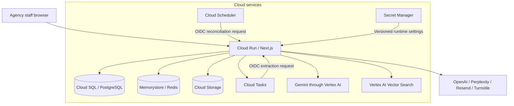

# Vidicy

AI document review for visa agencies.

Vidicy helps agency staff manage visa cases, collect documents, review AI findings, and track corrections before submission. The agency keeps control of the review. An AI evaluation does not determine a visa outcome.

The application is in `apps/agency`. It runs on Node.js and Cloud Run.

This README is the entry point for developers and technical reviewers. The [technical reference](apps/agency/README.md) covers service contracts, identities, failure handling, recovery, and dated deployment observations.

## Contents

- [Agency workflow](#agency-workflow)
- [Technology and services](#technology-and-services)
- [System architecture](#system-architecture)
- [AI configuration](#ai-configuration)
- [Runtime configuration](#runtime-configuration)
- [Commands](#commands)
- [Deployment](#deployment)
- [Technical documentation](#technical-documentation)
- [Code map](#code-map)

## Agency workflow

1. Create a case with the applicant, destination, visa type, and travel details.
2. Generate a document checklist for that case.
3. Upload PDFs or images and assign each file to a checklist requirement.
4. Extract document content and run an AI evaluation.
5. Review the findings. Resolve or dismiss tracked issues and check case readiness.
6. Replace or correct documents when needed. Document changes invalidate affected evaluations and reports.

The dashboard has views for applications, clients, documents, issues, reports, and staff. It also includes support tickets, announcements, account settings, and an admin area.

### Implementation limits

- The reports page lists stored client reports. Report generation and review finalization actions exist, but their `AgencyCaseToolbar` component is not mounted in the current case page. Report export and delivery are not complete user flows.
- Document chat endpoints remain in the code. Atlas is not a separate step in the current agency case interface.

## Technology and services

| Area | Current implementation |
| --- | --- |
| Web application | Next.js 16.1.6, React 19, TypeScript, App Router |
| Interface | Tailwind CSS 4, Radix UI components, Zustand, nuqs |
| Application hosting | Cloud Run with a standalone Next.js container |
| Database | Cloud SQL for PostgreSQL, `pg`, and Drizzle ORM |
| Documents and screenshots | Cloud Storage |
| Sessions, tokens, rate limits, and caches | Redis through the Memorystore adapter |
| Document context search | Vertex AI Vector Search |
| Document processing jobs | Cloud Tasks with authenticated internal HTTP routes |
| Recovery jobs | An internal document reconciliation route for Cloud Scheduler |
| Authentication | Email/password and Google OAuth; sessions stored in Redis |
| Email | Resend and React Email templates |
| CAPTCHA | Cloudflare Turnstile, when enabled |
| Error reporting | Sentry for Node.js |
| Runtime secrets | Secret Manager references injected into Cloud Run |
| Build and release | GitHub Actions, Cloud Build, and Artifact Registry |
| Operations | Cloud Logging for platform/build logs; application JSON logs and Sentry |

## System architecture



### Data and request flow

The server checks the user's session and case permission before accepting a document. It writes the file to Cloud Storage, commits its database record and checklist/review changes, then awaits Cloud Tasks acceptance before returning upload success.

Cloud Tasks calls an authenticated internal route on the same service. The route acquires a PostgreSQL lock for the document, extracts content, and indexes document chunks. Cloud Scheduler identifies old or failed work and reserves bounded recovery attempts. PostgreSQL remains authoritative for document identity and case state; vector results are checked against it before use.

These steps are separate service operations. File storage, SQL commit, and queue creation are not one atomic transaction. The [sequence diagram and failure map](apps/agency/README.md#system-boundaries) describe what can remain after a partial failure.

### Why the services fit this implementation

| Service | Role in this code | Technical boundary |
| --- | --- | --- |
| Cloud Run | Hosts the standalone Next.js server and processing routes | Web requests and document tasks share instance resources |
| Cloud SQL | Stores related case data and supports atomic SQL batches and advisory locks | Pool sizes and revision count determine connection pressure |
| Cloud Storage | Stores source files and larger vector metadata | Object generations identify bytes; storage writes do not join SQL transactions |
| Memorystore | Supplies TTL-based sessions, tokens, counters, and caches | Connection loss can affect user access; the current rate-limit sequence is not atomic |
| Cloud Tasks | Delivers work outside the original upload request | Delivery can repeat; handlers need locks, stable IDs, and reusable state |
| Cloud Scheduler | Starts periodic recovery and metadata cleanup | Recovery is bounded and can require operator action |
| Vertex AI models | Extract document content and produce structured review output | Provider access, schema checks, model quality, and request deadlines are separate concerns |
| Vertex AI Vector Search | Retrieves filtered document context | Serving updates are asynchronous; database identity checks protect retrieval |
| Secret Manager and IAM | Supply runtime credentials and restrict machine access | User OAuth, runtime ADC, deployment federation, and task OIDC are different identity paths |

See the [service-by-service reference](apps/agency/README.md#cloud-run) for the implementation details and source links. The [observed deployment profile](apps/agency/README.md#observed-deployment-profile) records actual settings from 19 October 2026. Those settings can change independently of this repository.

## AI configuration

These are the model IDs requested by the checked-in code. The project must have access to the configured models and services.

| Task | Provider and configured model |
| --- | --- |
| Document extraction | Vertex AI: `gemini-3.8-flash` |
| Document evaluation | Vertex AI: `gemini-4-argon` |
| Checklist research | Perplexity: `sonar-pro` |
| Structured checklist generation | OpenAI: `gpt-4o` |
| Document embeddings | OpenAI: `text-embedding-3-small`, with 1,536 dimensions |
| Evaluation translation | OpenAI: `gpt-4.1-mini` |
| Document chat | OpenAI: `gpt-5.4`, with `gpt-4.1` as fallback |

PDF extraction first tries native text extraction. It then tries Gemini when needed. OpenAI extraction fallback uses `gpt-4.1`, then `gpt-4.1-mini`.

`GEMINI_DOCUMENT_EXTRACTION=false` disables Gemini extraction. `OPENAI_DOCUMENT_EXTRACTION_FALLBACK=false` disables the OpenAI extraction fallback. Both paths are enabled by default outside tests. Document evaluation uses Vertex AI and does not switch to OpenAI when the provider fails.

Model constants are in [gemini.ts](apps/agency/src/lib/gemini.ts). Extraction is in [pdf-parser.ts](apps/agency/src/services/pdf-parser.ts). Evaluation is in [gemini-evaluation.ts](apps/agency/src/lib/gemini-evaluation.ts).

## Runtime configuration

The application requires PostgreSQL, Redis, Cloud Storage, Vertex AI, and Cloud Tasks. Provision these services and grant the Cloud Run service identity the required access before deployment. The repository does not provision a complete cloud environment.

Configure the service with `NEXT_PUBLIC_SITE_URL`, `GOOGLE_CLOUD_PROJECT`, `GOOGLE_CLOUD_LOCATION`, `GOOGLE_CLOUD_REGION`, and `GCS_DOCUMENT_BUCKET`. Set `DATABASE_URL` or the standard `PGHOST`, `PGPORT`, `PGDATABASE`, `PGUSER`, and `PGPASSWORD` variables for PostgreSQL, and `REDIS_URL` for Redis. Cloud Run can use a Cloud SQL socket path in `PGHOST`.

The cloud service adapters use Application Default Credentials from the Cloud Run service identity. Store private provider values in Secret Manager and inject them into the service configuration.

Configure these values for the features you use:

| Feature | Environment variables |
| --- | --- |
| Google OAuth | `GOOGLE_CLIENT_ID`, `GOOGLE_CLIENT_SECRET` |
| Turnstile | `NEXT_PUBLIC_TURNSTILE_SITE_KEY`, `TURNSTILE_SECRET_KEY` |
| OpenAI | `OPENAI_API_KEY` |
| Perplexity | `PERPLEXITY_API_KEY` |
| Email | `RESEND_API_KEY`, `EMAIL_FROM`, `EMAIL_FROM_NAME`; optional `EMAIL_REPLY_TO` |
| Error reporting | `SENTRY_DSN` |
| Vector search | `VERTEX_VECTOR_INDEX`, `VERTEX_VECTOR_INDEX_ENDPOINT`, `VERTEX_VECTOR_DEPLOYED_INDEX_ID`, `VERTEX_VECTOR_PUBLIC_ENDPOINT_DOMAIN` |
| Document tasks | `GOOGLE_CLOUD_SERVICE_ACCOUNT`, `DOCUMENT_TASK_BASE_URL` |
| SQL diagnostics | Optional `DB_SQL_LOG=true` |

Google OAuth uses `${NEXT_PUBLIC_SITE_URL}/sso/google/callback`. Register that exact callback in the OAuth client. Add the application hostname to Turnstile when CAPTCHA is enabled.

The vector index and endpoint must be in the same project and region. The index must accept 1,536-dimensional embeddings.

Document uploads queue extraction work in `vidicy-document-extraction`. `DOCUMENT_TASK_BASE_URL` must be an HTTPS `run.app` origin. It is both the task destination and the OIDC audience. `GOOGLE_CLOUD_SERVICE_ACCOUNT` identifies the account permitted to call the internal routes.

### Schema changes

Generate named PostgreSQL migrations with `pnpm db:generate:agency <name>`. Review the generated SQL and metadata, then apply the schema change to the intended database before deploying code that requires it. Database schema changes are separate from the image release.

## Commands

Run these from the repository root:

| Command | Effect |
| --- | --- |
| `pnpm dev` | Start the agency development server on port 3002 |
| `pnpm build` | Build the workspace application |
| `pnpm lint` | Run the application ESLint command |
| `pnpm test` | Run the standard Vitest suite; exclude model evaluation suites |
| `pnpm db:generate:agency <name>` | Generate a named PostgreSQL migration |
| `pnpm db:migrate:dev:agency` | Apply PostgreSQL migrations to the configured target |
| `pnpm --filter @vidicy/agency run build:analyze` | Build with bundle analysis |
| `PORT=3002 pnpm --filter @vidicy/agency run preview` | Serve an existing production build with Next.js |
| `pnpm --filter @vidicy/agency run email:dev` | Open the email preview server on port 3003 |
| `pnpm --filter @vidicy/agency run eval` | Run the separate model evaluation suites |
| `pnpm deploy:agency` | Build and deploy the container to the configured Cloud Run service |
| `pnpm --filter @vidicy/agency run deploy:google:build` | Build and publish the container without deploying it |

`preview` serves an existing production Next.js build.

## Deployment

The [deployment workflow](.github/workflows/deploy.yml) runs on pushes to `main` and on manual dispatch. It:

1. Authenticates with Workload Identity Federation.
2. Builds the application container with [Cloud Build](apps/agency/cloudbuild.yaml).
3. Pushes the image to Artifact Registry.
4. Updates the Cloud Run service using the immutable image digest.

The checked-in workflow and manual deployment script target project `eco-azimuth-441108-s4`, region `asia-southeast1`, and service `vidicy-agency`. The workflow also restricts deployment to the configured GitHub repository ID. Review these settings before using a different repository or project.

The release updates only the container image. It preserves the service identity, network attachments, runtime variables, secrets, and access policy. Database migrations are a separate release step; the workflow does not apply them.

Cloud Tasks calls `/api/internal/document-extraction`. Cloud Scheduler can call `/api/internal/document-reconciliation` to recover pending work. Both routes check the caller's Google identity token. Their queues, schedules, permissions, and service configuration must already exist.

`/api/health` checks PostgreSQL, Redis, and Cloud Storage. It requires an admin session.

## Technical documentation

The [technical reference](apps/agency/README.md) covers architecture, design choices, service behavior, and reliability evidence. Service-specific sources are linked next to the relevant explanation.

| Question | Reference |
| --- | --- |
| What happens between upload and completed indexing? | [System boundaries and sequence](apps/agency/README.md#system-boundaries) |
| What is deployed, and what is only configured in source? | [Dated deployment observations](apps/agency/README.md#observed-deployment-profile) |
| How do SQL transactions, Redis TTLs, and object generations work here? | [SQL](apps/agency/README.md#cloud-sql-for-postgresql), [Redis](apps/agency/README.md#memorystore-for-redis), [Storage](apps/agency/README.md#cloud-storage) |
| How are duplicate jobs and failed uploads handled? | [Task delivery and reconciliation](apps/agency/README.md#cloud-tasks-and-cloud-scheduler) |
| How are AI output and retrieved document context checked? | [Gemini](apps/agency/README.md#gemini-on-vertex-ai), [Vector Search](apps/agency/README.md#vertex-ai-vector-search) |
| Which identity can access which service? | [Identity, IAM, and secrets](apps/agency/README.md#identity-iam-and-secrets) |
| How is a container built, released, or rolled back? | [Release contract](apps/agency/README.md#build-release-and-rollback) |
| What should operators measure or investigate? | [Monitoring and SLOs](apps/agency/README.md#monitoring-and-service-objectives), [recovery](apps/agency/README.md#recovery-procedures) |
| Where does document data go, and how long can it remain? | [Location and retention](apps/agency/README.md#data-location-and-retention) |
| What limits processing capacity and cost? | [Capacity and cost controls](apps/agency/README.md#capacity-and-cost-controls) |
| What is incomplete or still needs an operating decision? | [Current limits](apps/agency/README.md#current-limits-and-follow-up-work) |

The documentation distinguishes source behavior, observed service settings, and recommended controls. It does not treat an architecture diagram, a managed service, or a successful container build as proof of measured availability, accuracy, load capacity, or disaster recovery.

## Code map

```text
apps/agency/
  src/
    actions/                Case, checklist, evaluation, and account actions
    app/                    Public pages, dashboard, case workspace, and API routes
    components/agency/      Case document desk, issue controls, and shared agency UI
    db/schema/              Current PostgreSQL schema
    db/postgres-migrations/ PostgreSQL migrations and Drizzle metadata
    infra/google/           Storage, Redis, vectors, task delivery, and service authentication
    infra/runtime-context.ts Cloud service interfaces
    lib/                    Model clients and shared application helpers
    server/                 Agency queries, issue synchronization, and readiness rules
    services/               PDF extraction and document processing
    __tests__/              Unit cases, route cases, and model evaluation suites
  scripts/                  Deployment and maintenance tools
  Dockerfile                Cloud Run application image
  cloudbuild.yaml           Cloud Build configuration
```

## License

[MIT](LICENSE). Keep the license and its attribution when distributing the source.
