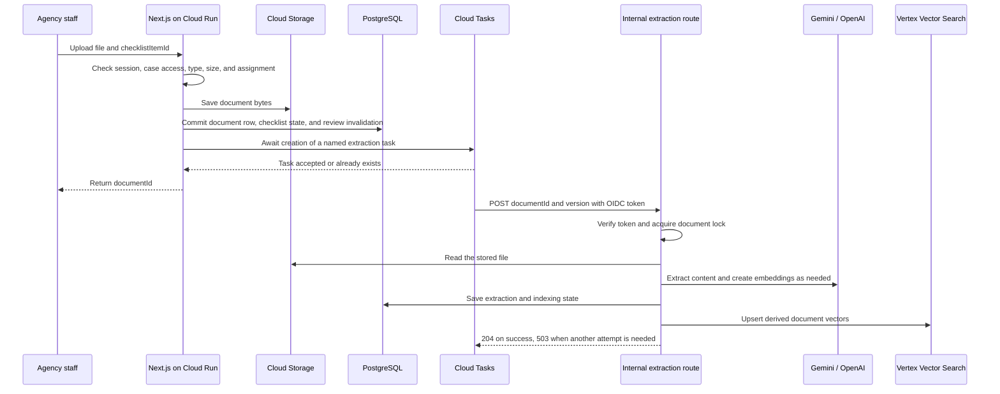
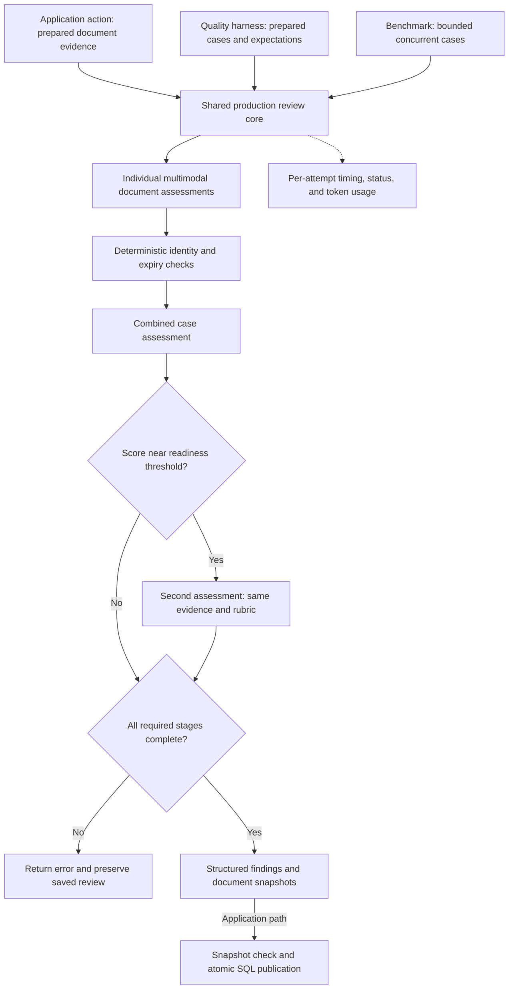
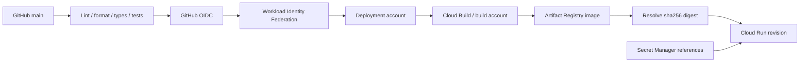

# Vidicy: technical reference

Vidicy combines multimodal evidence preparation, semantic retrieval, staged Gemini assessment, and reviewer-controlled case state. This reference explains how those parts preserve document identity, control model execution, publish consistent results, and recover client handoff after uncertain provider outcomes. Use the [main README](../../README.md) for the product workflow and runtime configuration.

This reference links the implementation to its source, tests, and service contracts. Deployment settings are supplied through the runtime configuration; the release path updates the application image.

## Contents

- [System boundaries](#system-boundaries)
- [Engineering contracts](#engineering-contracts)
- [Review pipeline](#review-pipeline)
- [Cloud Run](#cloud-run)
- [Cloud SQL for PostgreSQL](#cloud-sql-for-postgresql)
- [Cloud Storage](#cloud-storage)
- [Memorystore for Redis](#memorystore-for-redis)
- [Cloud Tasks and Cloud Scheduler](#cloud-tasks-and-cloud-scheduler)
- [Gemini on Vertex AI](#gemini-on-vertex-ai)
- [Vertex AI Vector Search](#vertex-ai-vector-search)
- [Identity, IAM, and secrets](#identity-iam-and-secrets)
- [Build, release, and rollback](#build-release-and-rollback)
- [Monitoring](#monitoring)
- [Recovery procedures](#recovery-procedures)
- [Data location and retention](#data-location-and-retention)
- [Capacity and cost controls](#capacity-and-cost-controls)
- [Configuration and code map](#configuration-and-code-map)

## Terms used here

| Term   | Meaning                                                                                          |
| ------ | ------------------------------------------------------------------------------------------------ |
| ADC    | Application Default Credentials: how the cloud client libraries obtain their configured identity |
| IAM    | Identity and Access Management: policies that grant access to cloud resources                    |
| OIDC   | OpenID Connect: the signed identity-token format used for machine calls here                     |
| VPC    | Virtual Private Cloud: the network path for configured private resources                         |
| TTL    | Time to live: when a Redis value expires                                                         |
| CRC32C | A checksum used to detect transfer corruption                                                    |

## System boundaries

One Next.js service handles the web interface, server actions, document APIs, and internal processing routes. PostgreSQL and Cloud Storage hold authoritative case data and document bytes.

| Information                                                          | Authoritative store                                           | Derived or temporary representation               |
| -------------------------------------------------------------------- | ------------------------------------------------------------- | ------------------------------------------------- |
| Cases, applicants, checklist assignments, findings, and report state | PostgreSQL                                                    | Page models and cached counts                     |
| Uploaded document bytes                                              | Cloud Storage                                                 | Parsed text and rendered page images              |
| Extracted text and processing state                                  | PostgreSQL                                                    | Embeddings and retrieved snippets                 |
| Searchable document chunks                                           | PostgreSQL text is the source; the search index is derived    | Vertex vectors and Cloud Storage metadata objects |
| Sessions, auth tokens, rate-limit counters, and caches               | Redis for the active value                                    | Cookies contain session references                |
| Work delivery                                                        | Cloud Tasks for queued work; PostgreSQL for document progress | Scheduler identifies work that needs recovery     |

The upload path coordinates three service operations: object storage, a SQL transaction, and queue acceptance. Persisted processing state supports recovery between these steps.



Extraction and indexing record progress in separate status fields. The [upload handler](src/app/api/_utils/document-upload.ts) and [pipeline](src/services/document-pipeline.ts) define the operation order and retry behavior.

### HTTP interfaces

| Route                                        | Caller contract                                                                                                                               | Result                                                                               |
| -------------------------------------------- | --------------------------------------------------------------------------------------------------------------------------------------------- | ------------------------------------------------------------------------------------ |
| `POST /api/documents/upload/pdf`             | App session and case permission; multipart `file`, `applicationId`, `checklistItemId`; optional `applicantId` must match the case/requirement | Accepted upload returns `documentId`, name, and size after enqueue acceptance        |
| `POST /api/documents/upload/image`           | Same ownership contract; JPEG or PNG file                                                                                                     | Same accepted-upload shape                                                           |
| `GET /api/document-preview/[documentId]`     | App session and case permission; optional `download=1`                                                                                        | Authorized byte stream or missing/denied response                                    |
| `POST /api/internal/document-extraction`     | Verified machine OIDC token; JSON `{ documentId, version }`                                                                                   | 204 when this attempt is complete or obsolete; retryable processing failures use 503 |
| `POST /api/internal/document-reconciliation` | Verified machine OIDC token; no document payload required                                                                                     | Recovery/cleanup summary; 503 on recorded work failures                              |
| `GET /api/health`                            | Admin session                                                                                                                                 | Component status and latency; can perform a Redis canary write                       |

The upload handler uses 400 for invalid input and 503 for explicit storage failure. An unexpected failure, including an enqueue failure after SQL commit, reaches its generic 500 response. Authentication and authorization helpers can reject a request before these operations. The task worker has a separate status contract described below.

### Design choices

| Choice                                          | Engineering purpose                                                                                       |
| ----------------------------------------------- | --------------------------------------------------------------------------------------------------------- |
| Shared web and task service                     | Use the same application code, document pipeline, and database contracts for interactive and queued work. |
| Queue acceptance before upload success          | Confirm that document work has a durable delivery record before acknowledging the upload.                 |
| PostgreSQL as document authority                | Check retrieved evidence against current document identity, case state, and access rules.                 |
| Named tasks, document locks, and stored results | Coordinate repeated delivery and reuse completed work.                                                    |
| Container digest releases                       | Deploy an exact image artifact after the code checks pass.                                                |

## Engineering contracts

The implementation defines correctness at the boundaries between model calls, SQL state, stored files, and external delivery. The following contracts connect those decisions to executable tests.

| Contract                                                             | Implementation                                                                                                                                                                                                                             | Verification                                                                                                                                                                                                                                                  |
| -------------------------------------------------------------------- | ------------------------------------------------------------------------------------------------------------------------------------------------------------------------------------------------------------------------------------------ | ------------------------------------------------------------------------------------------------------------------------------------------------------------------------------------------------------------------------------------------------------------- |
| Application and model-quality tests use one review implementation    | [case-evaluation.ts](src/services/case-evaluation.ts) owns the prompts, schemas, individual assessments, consistency checks, combined review, and conditional second pass. Prepared-evidence tools call the same function.                 | [Core tests](src/__tests__/case-evaluation.test.ts) cover production stages, fixed reference dates, bounded concurrency, and retained structured evidence.                                                                                                    |
| A completed review requires every required model stage               | Individual, combined, and required skeptical-stage failures reject the new review. The [action](src/actions/evaluation.action.ts) publishes only after the core returns; stored completion status gates later use.                         | [Core tests](src/__tests__/case-evaluation.test.ts) exercise provider, JSON, and schema failures. [Workflow tests](src/__tests__/agency-review.test.ts) check that failures preserve saved case state.                                                        |
| Corrected evidence and newer reviewer decisions remain authoritative | [agency-review.ts](src/server/agency-review.ts) checks document snapshots, publishes related SQL writes atomically, and conditions issue updates on the state read during synchronization.                                                 | [Database workflow tests](src/__tests__/agency-review.test.ts) exercise corrected uploads, rollback, concurrent decisions, issue reopening, and readiness checks.                                                                                             |
| Model retries have one owner and one stage deadline                  | The [Gemini adapter](src/lib/gemini-evaluation.ts) disables nested SDK retries, bounds transient retries, and records every attempt. The core waits for active document calls before returning a failure.                                  | [Adapter tests](src/__tests__/evaluation-action.test.ts) check retry count, spacing, shared deadlines, inline images, and usage. [Core tests](src/__tests__/case-evaluation.test.ts) check that a failure stops new document work and waits for active calls. |
| An uncertain email outcome preserves the original send identity      | [client-reports.ts](src/server/client-reports.ts) saves the complete request and idempotency key before the provider call. Versioned SQL claims serialize competing send attempts and protect case state.                                  | [Delivery tests](src/__tests__/client-report-delivery.test.ts) cover overlapping sends, identical retries, changed cases, recipient locking, legacy requests, and retry-window expiry.                                                                        |
| Concurrent measurements retain their own calls and failures          | [AsyncLocalStorage metrics](src/infra/evaluation-metrics.ts) isolate each collector. The [benchmark](src/__tests__/eval/framework/benchmark.ts) retains failures, calculates completed-case percentiles, and leaves unknown cost unpriced. | [Measurement tests](src/__tests__/evaluation-benchmark.test.ts) check isolation, concurrency limits, throughput, percentiles, failure retention, and token-cost accounting.                                                                                   |

The [browser suite](tests/report-workflow.pw.ts) adds checks across real application routes with private PostgreSQL, Redis-backed sessions, and controlled document/email stubs. It covers source selection, review decisions, report generation and delivery recovery, access controls, URL state, and responsive layouts.

## Review pipeline

The review pipeline converts route requirements and uploaded evidence into findings that agency staff can act on. Its main entry points are [checklist.action.ts](src/actions/checklist.action.ts), [evaluation.action.ts](src/actions/evaluation.action.ts), [case-evaluation.ts](src/services/case-evaluation.ts), and [agency-review.ts](src/server/agency-review.ts). The action prepares evidence and publishes results. The shared core runs the production prompts, schemas, per-document checks, combined assessment, and skeptical pass. Quality and benchmark tools call this same core. Each stage has a separate purpose and an explicit failure path.



| Stage                           | Inputs and computation                                                                                                                                                                                                                              | Output used by the application                                                                                                          |
| ------------------------------- | --------------------------------------------------------------------------------------------------------------------------------------------------------------------------------------------------------------------------------------------------- | --------------------------------------------------------------------------------------------------------------------------------------- |
| Route research and checklist    | Perplexity is prompted for official requirements by visa type, destination, passport country, and embassy. OpenAI structures the research with applicant context. Cached research or model knowledge can be used when live research is unavailable. | Validated, deduplicated requirements with required/optional status; source mode and available citations are saved as checklist metadata |
| Evidence preparation            | The shared extraction pipeline reuses stored text or extracts content from PDF and image uploads. Evaluation can load supported document images and PDF metadata.                                                                                   | Text, visual evidence, processing state, and metadata signals associated with the uploaded document                                     |
| Relevant context retrieval      | For indexed documents, checklist names and descriptions are embedded and used to retrieve document-scoped chunks. Retrieved candidates are checked against PostgreSQL identity and case state.                                                      | Relevant text for the per-document prompt; unavailable retrieval falls back to the text prefix                                          |
| Individual document assessment  | Parallel Gemini calls receive requirement details, application context, text, available images, and metadata signals. Missing files are represented directly by code.                                                                               | Status, score, issues, strengths, confidence, and structured fields such as holder name, expiry, and language                           |
| Combined assessment             | Code compares extracted holder names and expiry dates. A Gemini call combines these checks with per-document results, missing requirements, and case context.                                                                                       | Overall score, risk level, summary, and recommendations, with feedback keyed to checklist items                                         |
| Skeptical second pass           | For a primary score within 12 points of the visa-type readiness threshold, another Gemini call uses the same case summary with a skeptical system prompt.                                                                                           | Score divergence and a confidence label; scores are averaged when divergence reaches 8 points                                           |
| Publication and reviewer action | A transaction checks the document snapshot and saves the evaluation, tracked findings, scores, and report state together. Reviewers can resolve or dismiss issues and add manual issues.                                                            | Findings remain part of the case correction workflow; changed evidence invalidates affected review and report state                     |

The skeptical pass uses the same Gemini model, evidence, rubric, and point weights as the primary assessment. It checks unsupported claims and concrete contradictions. Its confidence label describes agreement between the two assessments. Deterministic name checks preserve Unicode letters and marks and remove leading courtesy titles before comparison.

The Gemini adapter owns retries explicitly. It permits at most two retries for HTTP 429 or 503 within the original 120-second stage deadline. Delays start at two and four seconds, each with up to one second of jitter. Each SDK call permits one attempt. Each attempt records status, duration, and available token usage. Other errors, including a provider timeout, are returned without another attempt. These bounds follow the [provider retry guidance](https://cloud.google.com/vertex-ai/generative-ai/docs/model-reference/api-errors).

### Evidence selection and reuse

The evaluator prefers a machine translation when one is available. Otherwise, it uses retrieved relevant chunks when available, then falls back to the first 8,000 characters of extracted text. It can also send uploaded images or rendered previews of up to three PDF pages to Gemini. Translation is requested explicitly on later runs when a previous evaluation identified a non-English document; the first-run prompt asks the model to translate internally.

Per-document feedback can be reused when a saved version key matches the document ID, configured evaluation model, and availability of text and images. Saved feedback retains the extracted identity, expiry, issuer, language, and date-range fields. A reused document therefore still participates in current name, expiry, and language checks. Uploaded documents with legacy feedback that lacks these fields are evaluated again once. This avoids some repeated per-document model calls without dropping structured evidence. The combined assessment still runs. Stored extraction, completed indexing, and a seven-day route-research cache provide separate reuse paths.

### Publication and readiness

The Gemini adapter requests structured output and the shared core applies response schemas and field defaults. A failed individual review, combined assessment, or required skeptical pass rejects the new review before publication. The action returns an explicit retry message and leaves earlier saved results unchanged. Successful publication sets `reviewStatus` to `complete`. Current-review checks require this status before reports, delivery, or readiness approval. Apply migration `0005_review_completion_status` before rollout; existing rows remain `incomplete` because their model-stage completion cannot be established. Staff must run those reviews again. The workspace shows a warning for an incomplete or outdated review. The final risk label is derived from the final score after skeptical averaging so they remain consistent.

Snapshot checks reject publication against corrected uploads. Conditional issue updates protect a reviewer decision made after synchronization read the issue. Server-side readiness checks require a current review, all required uploads, and no open issues. Staff retain control of issue decisions. The [case workspace](<src/app/(workspace)/dashboard/[appId]/_agency-case-content.tsx>) brings preview, requirements, findings, issue controls, and report actions together.

### Client report handoff

The case toolbar creates a report from client-visible open issues after checking the current review. The report and case state are saved together with a case-version check. Staff can open the private report from the case or report list, download escaped HTML, or print/save a PDF. Historical reports are marked as out of date and cannot be sent as current corrections.

[client-reports.ts](src/server/client-reports.ts) claims delivery in a short transaction, then calls the email provider outside it. The complete provider request, including sender and reply address, is saved before the first attempt and reused with its idempotency key after an ambiguous failure. Staff can save a missing or corrected case recipient before delivery starts; the saved recipient is locked after that point. Pending reports without a saved complete request require a provider check before another report is prepared. Concurrent sends are rejected, and an accepted report is not sent again. Acceptance stores the provider message ID; a case changed during delivery retains its draft state while the accepted report remains history. Retries wait at least two minutes and stop before the provider's idempotency retention expires. Provider acceptance does not prove inbox delivery. Apply [the report delivery migration](src/db/postgres-migrations/0003_client_report_delivery.sql) and [the complete request migration](src/db/postgres-migrations/0004_client_report_request_snapshot.sql) before rollout.

This separates three facts: the database has claimed a delivery attempt, the provider has accepted a message, and the case still matches the report. A timeout cannot safely be treated as proof that no message was sent. Saving the request and key makes the ambiguous outcome recoverable without changing the message identity. The version check also prevents a late provider response from marking corrected case evidence as already sent.

## Cloud Run

### Container and request lifecycle

[Dockerfile](Dockerfile) uses Node.js 22 on Debian Bookworm. It installs pnpm 10.27.0, builds Next.js standalone output, and runs `apps/agency/server.js` as the `node` user. The server listens on `0.0.0.0` and port 8080. The [container runtime contract](https://docs.cloud.google.com/run/docs/container-contract) defines port, request, and file-system requirements.

[Next.js configuration](next.config.ts) includes the task SDK protocol files and native canvas dependencies in standalone tracing. These files are needed for task delivery and PDF page rendering.

`getRuntimeContext()` provides access to the cloud service adapters. Its `ctx.waitUntil()` uses Next.js `after()` for short follow-up work. Document extraction uses Cloud Tasks so it has a durable delivery record. See [runtime-context.ts](src/infra/runtime-context.ts).

Configure Cloud Run request timeout separately from the task dispatch deadline and model deadlines. Extraction tasks use a 1,800-second dispatch deadline; model calls have shorter client deadlines.

### Concurrency and network access

Concurrency is the number of requests an instance can serve at once. It is not the number of active users. PDF rendering, buffered uploads, SQL connections, and model requests compete for the same resources.

Private Redis connectivity needs the configured VPC route. The [Direct VPC egress guide](https://docs.cloud.google.com/run/docs/configuring/vpc-direct-vpc) explains the network, subnet, and egress controls. Verify network attachments in the service configuration; the image release does not provision them. External OpenAI, Perplexity, Resend, and Turnstile calls also need outbound connectivity.

## Cloud SQL for PostgreSQL

[db/index.ts](src/db/index.ts) creates one shared `pg.Pool` for ordinary database work per Node.js process. It accepts `DATABASE_URL` or the standard `PG*` variables. `PGPOOL_MAX` defaults to 5. The pool waits up to 10 seconds for a connection and releases idle connections after 30 seconds.

The production schema is [db/schema](src/db/schema/index.ts). Drizzle uses the PostgreSQL driver. JSON, timestamp, nullable-join, and `RETURNING` behavior stays in the driver.

### Transactions and locks

`db.withTransaction()` checks out one connection, runs `BEGIN`, executes the supplied callback, and commits or rolls back the group. `db.batch()` uses the same transaction helper for a list of Drizzle queries. `AsyncLocalStorage` routes queries from both paths, including queries in called helpers, to the checked-out connection. Nested transactions are rejected. Keep network and AI calls outside these transactions.

The [case creation action](src/actions/agency-case.action.ts) resolves or creates the client, inserts the case, and inserts its primary applicant in one transaction. If a required write fails, client changes and both inserts roll back. This transaction does not include storage, queue creation, or model calls.

The upload transaction creates the document row, updates its checklist item, and invalidates review state together. Review synchronization also checks document snapshots before accepting findings.

For existing review issues, [agency-review.ts](src/server/agency-review.ts) conditions updates and automatic resolution on the saved `updateCounter`, status, and `resolvedAt` values. An update is skipped if one of these values changed since the read. This protects a newer reviewer decision from that stale synchronization attempt. Changed evidence can still reopen an issue through the normal review rules.

The extraction route uses a **separate pool of 3 connections** for session-level PostgreSQL advisory locks. A lock identifies one document. Model inference does not hold a SQL transaction open. The connection remains checked out until the attempt ends. If lock release fails, the connection is discarded.

### Connection budget

A useful planning estimate is:

```text
ordinary application connections ~= active instances × (main pool + lock pool)
```

This is a planning estimate, not a hard ceiling. Allow for overlapping revisions, migrations, administrator connections, and brief scaling overshoot. See the guidance on [Cloud Run SQL connections](https://docs.cloud.google.com/sql/docs/postgres/connect-run), [connection management](https://docs.cloud.google.com/sql/docs/postgres/manage-connections), and [maximum-instance behavior](https://docs.cloud.google.com/run/docs/configuring/max-instances).

### Schema release contract

[drizzle.config.ts](drizzle.config.ts) defines PostgreSQL schema generation. `pnpm db:generate <name>` generates a named migration. `pnpm db:migrate` applies the schema to the configured PostgreSQL database.

The release workflow does not migrate the database. Review and apply schema changes separately. Use compatible schema changes when old and new revisions can serve traffic at the same time.

## Cloud Storage

[storage.ts](src/infra/google/storage.ts) uses `@google-cloud/storage` and Application Default Credentials. It provides the object operations used by existing callers: `get`, `head`, `put`, `delete`, and paginated `list`.

- Writes buffer the input, use `resumable: false`, and validate transfer integrity with CRC32C.
- HTTP metadata and custom metadata are preserved through the adapter.
- Reads first fetch metadata, then pin the byte stream to that object's generation. This avoids combining one generation's metadata with another generation's bytes.
- A missing object becomes `null`. Deletes ignore a missing object.
- List requests are paginated and limited to 1–1,000 entries.

See the service contracts for [object consistency](https://docs.cloud.google.com/storage/docs/consistency) and [request preconditions](https://docs.cloud.google.com/storage/docs/request-preconditions).

### Upload and preview contract

The document routes accept PDF, JPEG, and PNG uploads. The file limit is 10 MiB. The PDF limit is 40 pages when the upload page-count check can determine a count. A parse failure in that preliminary check does not prove that a PDF is valid or within the page limit; processing has further handling.

Each upload must name a checklist item in the same case. The server checks applicant and checklist ownership before saving the file. Preview checks the active session and case permission, then streams the object through `/api/document-preview/[documentId]`. This path does not issue a public object URL. Its response permits private browser caching for one hour.

See the [upload handler](src/app/api/_utils/document-upload.ts) for the checks and write sequence, and the [preview route](src/app/api/document-preview/[documentId]/route.ts) for authorized reads.

### Support screenshot deletion

[support-attachments.ts](src/server/support-attachments.ts) provides shared cleanup for ticket and account deletion. Cleanup runs after the associated support rows have been removed. Before deleting an object, it checks the user's screenshot prefix or the admin screenshot prefix, verifies that the object's `uploadedBy` metadata matches the stored author, and checks for remaining ticket or message references. A stored key alone is not proof of ownership.

Account cleanup also collects attachments from messages that the user wrote on other users' tickets. Objects with remaining references, including shared admin screenshots, are retained. Cleanup runs outside the SQL transaction and logs failures for investigation.

## Memorystore for Redis

[kv.ts](src/infra/google/kv.ts) adapts the required KV operations to a shared Redis connection. Runtime prefixes separate application data (`vidicy:app:`) from session/cache data (`vidicy:cache:`). Case access remains controlled by application permissions.

| KV operation               | Redis behavior                                                                                                                         |
| -------------------------- | -------------------------------------------------------------------------------------------------------------------------------------- |
| `get`                      | `GET`, with optional JSON decoding                                                                                                     |
| `take`                     | `GETDEL`: return and remove a value in one operation                                                                                   |
| `increment`                | Lua script with `INCR` and `EXPIRE` in one operation; renew the TTL                                                                    |
| `incrementWindow`          | Lua script that increments a counter, sets its initial TTL, and returns the count and remaining TTL without extending an active window |
| `put` with relative expiry | `SET ... EX`                                                                                                                           |
| `put` with absolute expiry | `SET ... EXAT`                                                                                                                         |
| Expiry already reached     | Delete the key                                                                                                                         |
| `delete`                   | `DEL`                                                                                                                                  |
| `list`                     | `SCAN` with prefix filtering and an opaque cursor                                                                                      |

The list cursor retains excess results because Redis `COUNT` is a hint. It is not a snapshot of keys during concurrent writes. Sessions use the cache namespace through `kv-session.ts`.

Connection setup has a 10-second timeout, bounded reconnect backoff, and a disabled offline command queue. Redis supplies active session and token state as well as cached data.

### Rate-limit windows and failures

[rate-limit.ts](src/infra/rate-limit.ts) uses `increment()` with a key for the configured clock-aligned window. The returned count determines whether the request is allowed. The key expires at the window boundary. Concurrent requests use the same atomic counter. Redis errors propagate to the caller; [with-rate-limit.ts](src/infra/with-rate-limit.ts) does not continue to the protected action after a counter error.

[action-rate-limit.ts](src/infra/action-rate-limit.ts) uses `incrementWindow()` for a per-user, per-action window. Its one-hour window starts with the first request. Later requests do not extend the window, and crossing a clock-hour boundary does not reset it. The versioned `rl:v2:` keys avoid the older JSON counter format. An exceeded limit raises `TOO_MANY_REQUESTS`. A Redis error is logged and the action is allowed to continue.

### Single-use password reset tokens

The [reset action](<src/app/(auth)/reset-password/reset-password.action.ts>) uses `take()` before the password write. Only one concurrent request can receive the token value. The action then checks the stored token state and expiry, updates the password, and invalidates the user's sessions.

Token consumption, the SQL password update, and Redis session deletion are separate operations. If a later password or session operation fails, the token remains consumed. The user must request a new reset link before another attempt.

## Cloud Tasks and Cloud Scheduler

### Delivery contract

Cloud Tasks can redeliver work and does not promise FIFO execution. See [Cloud Tasks issues and limitations](https://docs.cloud.google.com/tasks/docs/common-pitfalls). Handlers must tolerate repeated work.

[document-tasks.ts](src/infra/google/document-tasks.ts) creates a named HTTP task in `vidicy-document-extraction`:

```text
name suffix = SHA-256(JSON.stringify({ documentId, version }))
body        = { documentId, version }
target      = DOCUMENT_TASK_BASE_URL + /api/internal/document-extraction
audience    = DOCUMENT_TASK_BASE_URL origin
deadline    = 1,800 seconds
```

The default version is `initial`. An existing task name is treated as an accepted enqueue. Task-name retention determines the deduplication window.

The upload handler awaits queue creation before returning success. A queue error after SQL commit returns an error to the client while the queued document row remains available for reconciliation.

### Worker responses

The [extraction route](src/app/api/internal/document-extraction/route.ts) verifies identity before reading its bounded 4,096-byte JSON body. It acquires the document's advisory lock, checks that the document still exists, then runs extraction and indexing.

| Condition                                                      | Response | Delivery meaning                    |
| -------------------------------------------------------------- | -------- | ----------------------------------- |
| Missing or invalid identity token                              | 401      | Caller has not established identity |
| Valid token from the wrong verified account                    | 403      | Caller is not permitted             |
| Invalid payload                                                | 400      | Payload is not usable               |
| Document has been deleted                                      | 204      | Acknowledge obsolete work           |
| Extraction and indexing succeed                                | 204      | Acknowledge this attempt            |
| Lock is held, processing fails, or a dependency is unavailable | 503      | Another attempt is needed           |

The pipeline reuses stored extraction or a completed index when its state permits. An empty or failed extraction result can update the document only if the database still has no nonblank text. A late failed attempt therefore cannot erase text saved by a successful attempt. After a failed extraction attempt, `ensureDocumentExtraction()` reloads the row and returns stored text when another attempt has saved it. See [document-pipeline.ts](src/services/document-pipeline.ts).

HTTP target tokens, task service accounts, and retry behavior are described in the [HTTP task guide](https://docs.cloud.google.com/tasks/docs/creating-http-target-tasks) and [queue configuration guide](https://docs.cloud.google.com/tasks/docs/configuring-queues). Retry delivery, SDK request retries, and application recovery are three separate mechanisms.

### Bounded reconciliation

The [reconciliation route](src/app/api/internal/document-reconciliation/route.ts) is a scheduled repair path. It checks:

- Uploads still queued after 2 minutes.
- Extraction that is failed or still extracting after 10 minutes.
- Completed or partial extraction with indexing queued after 2 minutes.
- Failed or active indexing that has remained old for 10 minutes.

It excludes trashed cases, selects up to 30 documents, and enqueues in groups of 3. A database update reserves a recovery attempt atomically. Each document has up to 3 recovery claims and at most one claim per 15-minute bucket. A changing sort order reduces the chance that old failing records block newer records.

Recovery task versions include the time bucket. Each claim can have queue delivery retries. After the claim limit, an operator investigates the document and its dependency errors.

The same route processes bounded vector metadata cleanup. It returns 503 if enqueue or cleanup work fails. Configure its invocation schedule in Cloud Scheduler. The [Scheduler delivery contract](https://docs.cloud.google.com/scheduler/docs/overview) permits repeated invocation.

## Gemini on Vertex AI

[gemini.ts](src/lib/gemini.ts) creates a `GoogleGenAI` client with `vertexai: true`, a project, and a location. Location defaults to `global`. ADC is the normal identity source. The optional JSON credential override is used by this client only.

| Path       | Model constant     | Input and output contract                                                          |
| ---------- | ------------------ | ---------------------------------------------------------------------------------- |
| Extraction | `gemini-3.8-flash` | Inline PDF or image bytes and an extraction prompt; low thinking level; plain text |
| Evaluation | `gemini-3.8-flash` | Text and validated inline images; medium thinking level; JSON Schema output        |

Before changing a model ID, check project access, quota, supported location, and lifecycle in the [model catalog](https://docs.cloud.google.com/gemini-enterprise-agent-platform/models/google-models) and [release notes](https://ai.google.dev/gemini-api/docs/changelog).

### Extraction and evaluation controls

[pdf-parser.ts](src/services/pdf-parser.ts) first tries native PDF text. Gemini is used when that path cannot extract content. The image path also tries Gemini. Each Gemini extraction request has a 40-second client deadline and checks for empty output and an incomplete finish reason.

[gemini-evaluation.ts](src/lib/gemini-evaluation.ts) requests `application/json` with `responseJsonSchema`. It reserves up to 8,192 extra output tokens for thinking, with a total cap of 32,768. It rejects unsupported remote image URLs, empty output, incomplete generation, and invalid JSON. The evaluation action then applies its Zod schemas and transforms.

See the contracts for [structured output](https://docs.cloud.google.com/vertex-ai/generative-ai/docs/multimodal/control-generated-output) and supported [JSON Schema fields](https://docs.cloud.google.com/java/docs/reference/google-cloud-vertexai/latest/com.google.cloud.vertexai.api.GenerationConfigOrBuilder). Application consistency checks and reviewer decisions follow model parsing.

Extraction can fall back to OpenAI when enabled. Evaluation phases remain on Vertex AI and do not switch providers on a Vertex error. OpenAI still provides checklist structuring, translation, embeddings, and document chat; Perplexity still provides checklist research. The main README lists the exact configured IDs. If PDF-level extraction fails, the pipeline can render pages and run the enabled OpenAI page-extraction fallback in page order.

### Queued extraction and synchronous review

Cloud Tasks runs document extraction and indexing with queue retry and reconciliation. The [evaluation server action](src/actions/evaluation.action.ts) awaits the review phases during the interactive request. Staff can retry a failed review from the workspace.

### Quality evidence

Implementation checks and live model evaluation have separate commands and inputs.

| Test layer                                                           | Inputs and scope                                                                                                                                |
| -------------------------------------------------------------------- | ----------------------------------------------------------------------------------------------------------------------------------------------- |
| [Agency workflow tests](src/__tests__/agency-review.test.ts)         | Mocked model responses with real temporary PostgreSQL. Cover publication, rollback, corrected uploads, reviewer decisions, and readiness rules. |
| [Gemini adapter tests](src/__tests__/evaluation-action.test.ts)      | Controlled provider responses. Cover model selection, JSON schema, inline images, deadlines, retries, and usage collection.                     |
| [Review quality harness](src/__tests__/eval/evaluation-eval.test.ts) | Live production review core with prepared evidence. Check score ranges, expected findings, item status, recommendations, and risk consistency.  |
| [Checklist harness](src/__tests__/eval/checklist-eval.test.ts)       | GPT-4o with separate prompts. Check checklist structure and required-document coverage.                                                         |

`pnpm eval:review` enables live model calls. Each case must complete all required model stages. Failures remain in the results and pass-rate denominator. The harness records provider status and permits one bounded retry for rate limits. An unrecovered provider failure stops further cases and marks them unmeasured.

The built-in `synthetic-review-v5` dataset contains nine developer-authored cases. A complete reference covers all five areas of the production scoring rubric. Three variants change one document: a missing bank statement, an expired passport, or a different employee name. Each variant must produce the expected finding and score below the complete reference. A case with complete uploads but limited supporting evidence must also score below that reference.

These are synthetic regression expectations. Each required finding, recommendation, and reference comparison has its own check. Aggregate scores cannot hide a failed case. The [dataset loader](src/__tests__/eval/datasets/load-evaluation-cases.ts) rejects unknown references, self references, and score ranges that conflict with supplied risk levels.

`EVALUATION_CASES_FILE` selects a JSON dataset with `provenance` and `cases`. Cases can supply exact item statuses, recommendation labels, accepted keyword alternatives, and an `input.asOfDate` reference date. The core uses that date for prompts and expiry checks; the application uses the current UTC date. Saved results include model, source, harness, metric, and dataset hashes, attribution, and reference dates.

Quality runs process documents one at a time to control provider load. Prepared-evidence runs cover the review core; upload, extraction, retrieval services, SQL publication, and email have separate tests. Built-in synthetic runs retain model outputs for failure analysis. Supplied datasets omit those outputs.

## Vertex AI Vector Search

[vector-search.ts](src/infra/google/vector-search.ts) uses the index/index-endpoint API. It calls `upsertDatapoints`, `removeDatapoints`, and `findNeighbors` through the authenticated service request helper.

### Index contract

- Dense vectors must contain exactly 1,536 finite values.
- The configured index must use `COSINE_DISTANCE` and support streaming updates.
- Index and endpoint resource names must specify the same project and region.
- The deployed index ID and authenticated public endpoint domain are required.
- Writes use batches of up to 100 vectors; deletions use up to 1,000 IDs.
- Queries require an exact `applicationId` or `documentId` restriction and accept `topK` from 1 to 1,000.

The [streaming index guide](https://docs.cloud.google.com/vertex-ai/docs/vector-search/update-rebuild-index) explains that deployment updates are asynchronous. Its [filtering guide](https://docs.cloud.google.com/vertex-ai/docs/vector-search/filtering) explains categorical restrictions.

### Chunking and metadata

The [document pipeline](src/services/document-pipeline.ts) stores up to 50,000 characters of extracted text. Chunking targets 3,200 characters with 320 characters of overlap, using paragraph boundaries. Paragraph boundaries can produce larger chunks.

Embedding requests use OpenAI `text-embedding-3-small` in batches of up to 500 chunks, with a 25-second client deadline. A point ID is `${documentId}-${chunkIndex}`. Search metadata includes the case, document, chunk index, and up to 3,500 characters of chunk content.

Metadata above the adapter's 2,048-byte threshold is stored as a content-addressed JSON object in Cloud Storage. The vector retains identity fields and a pointer. A new metadata version does not overwrite text behind a previously indexed point.

### Retrieval and deletion correctness

The adapter fetches full datapoint metadata and checks each candidate against PostgreSQL. It rejects a deleted document, a trashed case, mismatched application identity, or a point ID that does not match the document/chunk format. Metadata object paths must match the expected document prefix and content hash format.

[vectorize-query.ts](src/lib/vectorize-query.ts) first requests 6 document-scoped neighbors. If necessary, it requests 24 case-scoped neighbors and retains the requested document's chunks. Only candidates that pass identity and state checks are returned.

After a point deletion is accepted, a manifest defers metadata cleanup for at least 24 hours. The scheduled cleaner checks that source documents no longer exist, processes up to 2 manifests per call, and retains failed work for a later attempt. User-facing authorization depends on the live database checks, not on waiting for the cleanup window to expire.

## Identity, IAM, and secrets

### Four identity paths

| Identity path            | How identity is established                                      | Purpose and scope                                                      |
| ------------------------ | ---------------------------------------------------------------- | ---------------------------------------------------------------------- |
| Agency user              | Email/password or Google OAuth, followed by an app session       | Application permissions control access to a case and its documents     |
| GitHub deployment        | GitHub OIDC token exchanged through Workload Identity Federation | Impersonates the deployment service account for build and release work |
| Running container        | Attached Cloud Run service account through ADC                   | Calls Storage, Tasks, and Vertex APIs and accesses configured secrets  |
| Task or Scheduler caller | Google-issued OIDC ID token                                      | Must match the internal route's audience and verified account email    |

An agency user's Google OAuth token is not the credential used to access the storage bucket or Vertex AI. The [service identity guide](https://docs.cloud.google.com/run/docs/securing/service-identity) explains deployment and runtime identities.

### GitHub trust boundary

The workflow has a repository-ID guard. Configure the workload identity provider to restrict credential exchange to the matching repository, owner, and release branch:

```text
repository_id       = 1424743538
repository_owner_id = 111155827
ref                 = refs/heads/main
```

The issuer is `https://token.actions.githubusercontent.com`. The workflow also has a repository-ID guard. The job guard controls workflow execution; the provider condition controls the cloud credential exchange. Both must remain correct after repository moves or release-branch changes. See the [deployment federation guide](https://docs.cloud.google.com/iam/docs/workload-identity-federation-with-deployment-pipelines).

### Permission responsibilities

Use these permission scopes when provisioning identities:

| Identity           | Capabilities it needs                                                                                                                                   | Important boundary                                                                                            |
| ------------------ | ------------------------------------------------------------------------------------------------------------------------------------------------------- | ------------------------------------------------------------------------------------------------------------- |
| Deployment account | Submit builds, read the source-staging bucket, read image metadata, update the target Run service, and act as the configured build/runtime identities   | Does not need unrestricted project ownership to perform these tasks                                           |
| Build account      | Read staged source, write the image repository, and write build logs                                                                                    | Build inputs must not contain runtime credentials or private exports                                          |
| Runtime account    | Read/write the document bucket, call the configured Vertex resources, enqueue document tasks, access selected secret versions, and connect to Cloud SQL | PostgreSQL login privileges and Redis AUTH are separate from service API IAM                                  |
| Task caller        | Establish the OIDC identity permitted by the internal-route verifier                                                                                    | The enqueuer needs permission to use this identity; the task delivery service must be able to issue its token |

### Internal endpoint authentication

[internal-auth.ts](src/infra/google/internal-auth.ts) verifies token signature and audience with Google's OAuth library, then requires `email_verified=true` and an exact account-email match. Task-name, queue-name, and Scheduler headers are not identity evidence.

`DOCUMENT_TASK_BASE_URL` accepts only an HTTPS `run.app` origin without a custom port, user information, query, fragment, or non-root path. The same origin is the task destination and OIDC audience.

The application verifier authenticates internal calls at the route boundary.

### Secret Manager and build-time values

Inject database, Redis, provider, OAuth, email, Turnstile, and Sentry secrets through numbered Secret Manager version references. Keep their values out of documentation and review output.

[Secret Manager integration for Cloud Run](https://docs.cloud.google.com/run/docs/configuring/services/secrets) resolves environment-backed secrets at instance startup; numbered versions make the selected value explicit. A rotation procedure must update the reference, deploy a revision, and verify affected flows. Updating only the image does not select a new secret version automatically.

`NEXT_PUBLIC_SITE_URL` and the Turnstile public site key are build arguments in `cloudbuild.yaml`. Next.js can compile public variables into client assets. A runtime environment change alone does not rebuild those assets. Private API keys belong in server-side secret configuration.

The shared REST adapter uses ADC with the `cloud-platform` scope. IAM grants still determine its access. `GOOGLE_APPLICATION_CREDENTIALS_JSON` is a Gemini-client override; it does not configure Storage, Tasks, or the shared REST adapter.

## Build, release, and rollback

### Current release path



The [workflow](../../.github/workflows/deploy.yml) is the release entry point. Before Google Cloud authentication or the container build, it requires `pnpm lint`, `pnpm format:check`, `pnpm typecheck`, and `pnpm test` to pass. It serializes agency production jobs with `cancel-in-progress: false`. The [Cloud Build configuration](cloudbuild.yaml) uses a dedicated build account, a 1,800-second build timeout, `CLOUD_LOGGING_ONLY`, and an `images` output for Artifact Registry. CI supplies `_IMAGE_TAG` from the commit SHA, resolves the published image digest, and updates Cloud Run with that digest.

The [deployment script](scripts/google-deploy.mjs) offers the same image build/update path for an operator. It validates the image tag and returned digest. `--build-only` publishes an image without updating Cloud Run.

The deploy step updates the image reference and preserves provisioned services and runtime settings. Apply required database migrations as a separate release step. Run the CI code checks before using the manual script. Both paths run the Next.js build and its configured TypeScript check during the container build.

The [Cloud Build to Cloud Run guide](https://docs.cloud.google.com/build/docs/deploying-builds/deploy-cloud-run) and [Artifact Registry integration](https://docs.cloud.google.com/artifact-registry/docs/integrate-cloud-run) describe the service boundaries used here.

### Code checks and isolated tests

Run `pnpm lint`, `pnpm format:check`, `pnpm typecheck`, and `pnpm test` from the repository root before release. CI installs PostgreSQL and Redis test tools and runs the same commands. The format check covers application source; generated migration metadata is excluded to preserve migration artifacts.

The standard suite covers units, component events, routes, and real local database behavior. [PostgreSQL tests](src/__tests__/helpers/postgres.ts) need `pg_config` on `PATH`, with `initdb` and `pg_ctl` in its binary directory. [Redis integration tests](src/__tests__/google-kv.integration.test.ts) need `redis-server` and `redis-cli` on `PATH`. Both use temporary processes with private Unix sockets and TCP disabled; they do not select application databases or Redis. The tests cover rollback, concurrent writes, rate-limit windows, token consumption, and deletion guards. Use each run's output as release evidence.

Build first, then run `pnpm test:e2e` for the [report browser test](tests/report-workflow.pw.ts). It starts a temporary production preview with private PostgreSQL and Redis, uses the real session and CSRF paths, and intercepts email transport. It checks report generation, download, rejected delivery, retry, provider acceptance, stale state, and non-staff/anonymous access. It sends no email and uses no application database. Install Playwright Chromium if it is not available.

`pnpm test` excludes `src/__tests__/eval/**`. Use `pnpm eval:review` for live review quality checks and `pnpm test:e2e` for browser workflow checks.

### Release records

The build source archive and container context have separate exclusion rules for private credentials and application data. The release resolves the image digest before updating Cloud Run.

Keep the commit SHA, workflow run, Cloud Build ID, image digest, ready revision, traffic allocation, schema version, and runtime configuration changes with the release record. Check the affected user journeys after release and retain those results.

### Rollback procedure

1. Select a previous revision with known-good application evidence.
2. Confirm that its code supports the current database schema and secret versions.
3. Route traffic to that revision using Cloud Run's revision controls.
4. Check traffic, user access, upload processing, and dependency health.
5. Record the incident and the configuration that served it.

See [revision rollback and traffic migration](https://docs.cloud.google.com/run/docs/rollouts-rollbacks-traffic-migration). Traffic rollback does not reverse database migrations, object writes, model calls, or completed task effects. Returning to an old image can require a separate data-recovery decision.

## Monitoring

The application exposes logs, error reports, dependency diagnostics, and document progress:

- Cloud Build sends build logs to Cloud Logging.
- The application logger writes JSON to stdout/stderr. Alert entries include `severity` and `alertCategory`.
- Sentry starts for Node.js when `SENTRY_DSN` is set, with a trace sample rate of 0.05.
- Document rows retain extraction status, indexing status, and recovery counters.
- Model metrics record each attempt's stage, model, status, duration, and available token usage. `AsyncLocalStorage` keeps concurrent collectors separate and excludes document text from these metrics.

The admin-only `/api/health` route checks PostgreSQL, a Redis write/read/delete cycle, and a storage object listing. Every request has a unique Redis canary key and value. Cleanup runs in `finally`, with a 60-second TTL as a second cleanup path. The route returns 200 for healthy or degraded status and 503 when all three checked components are down.

Use document progress, recovery counts, and provider status together to investigate delayed work. The [Cloud Run logging guide](https://docs.cloud.google.com/run/docs/logging) describes the platform log format.

## Recovery procedures

### Failure map

| Failure                                           | Persisted state that can remain           | Current recovery or next investigation                                                  |
| ------------------------------------------------- | ----------------------------------------- | --------------------------------------------------------------------------------------- |
| Storage write fails                               | No document row from this upload          | Fix storage access or availability; the client can retry                                |
| SQL commit fails after storage succeeds           | An unreferenced storage object            | Inspect the failed write and verify object ownership before cleanup                     |
| Enqueue fails after SQL commit                    | A document row in queued state            | Scheduler can reserve a recovery enqueue; inspect queue permissions and response errors |
| A task is delivered twice concurrently            | One document plus competing attempts      | Advisory lock allows one active attempt; another receives 503                           |
| A process stops during model work                 | Old extraction/indexing state             | Queue retry and later reconciliation can resume; an external call may repeat            |
| A document is deleted before its task starts      | Obsolete task                             | Worker returns 204                                                                      |
| Vector mutation succeeds before replicas catch up | Search results can lag                    | PostgreSQL existence/identity checks reject invalid candidates                          |
| Model quota or provider failure persists          | Failed work and growing task age          | Review quotas and provider errors; inspect bounded recovery claims                      |
| Redis is unavailable                              | Session/token operations can fail         | Restore connectivity or the service; session data loss can require sign-in again        |
| A new image fails                                 | New and previous revisions may both exist | Use a schema-compatible revision rollback                                               |

### Investigate a processing backlog

1. Identify a document by its ID, case, upload time, extraction status, indexing status, and recovery count. Do not paste its document content into operational logs.
2. Check queue state and current retry/dispatch settings. Check whether the Scheduler job is enabled and reaches the expected route.
3. Use the document ID to inspect route logs. Classify 401/403 as identity failures and 503 by lock, dependency, or processing failure.
4. Confirm the storage object and database row still refer to the same document. Check Vertex/model access and SQL/Redis connectivity.
5. If recovery claims are exhausted, resolve the cause before a reviewed requeue or correction.

Task names contain a hash. Use the task payload to find the document ID and its stored processing state.

### Restore checks

After a restore, check case records against their storage objects, review snapshots, report state, and pending jobs. Rebuild derived vectors from authorized stored text with the configured embedding dimensions and identity filters. Check session validity and runtime identities before returning the application to users.

## Data location and retention

`GOOGLE_CLOUD_LOCATION` selects the Gemini endpoint and defaults to `global`. Deployment region and model endpoint are separate settings. See the [model location guide](https://docs.cloud.google.com/vertex-ai/generative-ai/docs/learn/locations).

| Destination           | Data used by the integration                                                                        |
| --------------------- | --------------------------------------------------------------------------------------------------- |
| Gemini through Vertex | PDF/image bytes for extraction; selected text and inline images for evaluation                      |
| OpenAI                | Chunk text for embeddings; checklist inputs; translation; chat context; enabled extraction fallback |
| Perplexity            | Checklist research inputs                                                                           |
| Resend                | Recipient addresses and email content                                                               |
| Sentry                | Captured errors and attached application context                                                    |

Document access uses application permissions and live database checks. Deletion updates case/document state, removes vectors, and schedules metadata cleanup. Storage recovery settings and database backup retention have separate lifetimes. Preview responses use private browser caching for one hour. Configure retention for each store and provider to match the deployment's data policy.

## Capacity and cost controls

Processing has explicit controls at each service boundary:

| Boundary          | Control                                                                                              |
| ----------------- | ---------------------------------------------------------------------------------------------------- |
| Document delivery | Queue dispatch settings, named tasks, and per-document advisory locks                                |
| Database access   | Shared application pool and a separate three-connection lock pool                                    |
| Review inference  | Two concurrent document calls per case by default; a 120-second deadline per model stage             |
| Repeat work       | Reuse of stored extraction, completed indexes, matching document feedback, and cached route research |
| Retrieval         | Bounded text, chunk batches, query candidate counts, and database identity checks                    |
| Recovery          | Bounded selections, atomic recovery claims, and grouped enqueue requests                             |

Review concurrency is scoped to each case. Queue settings control extraction delivery. Size these controls with instance resources, SQL connection capacity, and provider quotas. The shared review core and its measurement tools support comparisons of model quality, latency, retries, and token cost on the same inputs.

### Repeatable review measurements

`pnpm benchmark:review` runs the production review core with prepared evidence and saves JSON under `output/verification/`. Live model usage is billable.

| Setting                                                   | Purpose                                            |
| --------------------------------------------------------- | -------------------------------------------------- |
| `BENCHMARK_CASES`, `BENCHMARK_REPEATS`                    | Select the case count and repetitions              |
| `BENCHMARK_CONCURRENCY`, `BENCHMARK_DOCUMENT_CONCURRENCY` | Bound case workers and document calls              |
| `EVALUATION_CASES_FILE`                                   | Select a supplied dataset                          |
| `BENCHMARK_OUTPUT`                                        | Select the artifact path                           |
| `MODEL_RATES_FILE`                                        | Supply model-specific token rates and their source |

The default is two cases, one case worker, one repetition, and production document concurrency. Use `BENCHMARK_CASES=9` to include all built-in cases and their reference.

The artifact records model, source, harness, metric, and dataset hashes, provenance, concurrency, failures, token usage, completed throughput, and nearest-rank p50/p95 latency for completed cases. Failed cases remain visible. Reference comparisons are recorded for each repetition; an absent reference is unmeasured. Model-stage completion and quality checks have separate results. Artifacts exclude raw document text and model responses.

These measurements cover the prepared-evidence review core. Upload, extraction, retrieval services, SQL publication, HTTP load, and email are outside the benchmark. Compare matching model and implementation hashes when using saved results.

Token cost estimates use a rates object with `model`, `inputUsdPerMillion`, `cachedInputUsdPerMillion`, `outputUsdPerMillion`, and `source`. The model must match the configured review model. Reasoning output is included in total-minus-input usage. Missing cache counts receive no discount; missing usage or rates remain unknown. Estimates cover the review model's tokens.

## Configuration and code map

### Configuration contracts

| Setting                                                                    | Contract and consumer                                                                                    |
| -------------------------------------------------------------------------- | -------------------------------------------------------------------------------------------------------- |
| `GOOGLE_CLOUD_PROJECT`                                                     | Project used by the Gemini client, storage client, and task queue path                                   |
| `GOOGLE_CLOUD_LOCATION`                                                    | Generative model location; defaults to `global`                                                          |
| `GOOGLE_CLOUD_REGION`                                                      | Task region; defaults to `asia-southeast1`; does not relocate existing storage, SQL, or vector resources |
| `DATABASE_URL` or `PGHOST`, `PGPORT`, `PGDATABASE`, `PGUSER`, `PGPASSWORD` | PostgreSQL connection; production can use the attached Cloud SQL socket                                  |
| `PGPOOL_MAX`                                                               | Main database pool limit; default 5                                                                      |
| `REDIS_URL`                                                                | Redis connection URL                                                                                     |
| `GCS_DOCUMENT_BUCKET`                                                      | Document and vector metadata bucket                                                                      |
| `VERTEX_VECTOR_INDEX`                                                      | `projects/PROJECT/locations/REGION/indexes/NUMBER`                                                       |
| `VERTEX_VECTOR_INDEX_ENDPOINT`                                             | Matching `projects/PROJECT/locations/REGION/indexEndpoints/NUMBER`                                       |
| `VERTEX_VECTOR_DEPLOYED_INDEX_ID`                                          | Deployed index identifier used in neighbor queries                                                       |
| `VERTEX_VECTOR_PUBLIC_ENDPOINT_DOMAIN`                                     | Authenticated serving domain ending in `.vdb.vertexai.goog`                                              |
| `GOOGLE_CLOUD_SERVICE_ACCOUNT`                                             | Permitted task/Scheduler OIDC account email                                                              |
| `DOCUMENT_TASK_BASE_URL`                                                   | Canonical HTTPS `run.app` origin used as destination and audience                                        |
| `NEXT_PUBLIC_SITE_URL`                                                     | Canonical app origin, OAuth callback prefix, and public build configuration                              |
| `GEMINI_DOCUMENT_EXTRACTION`                                               | Set `false` or `0` to disable the Gemini extraction path                                                 |
| `OPENAI_DOCUMENT_EXTRACTION_FALLBACK`                                      | Set `false` or `0` to disable OpenAI extraction fallback                                                 |
| `GOOGLE_APPLICATION_CREDENTIALS_JSON`                                      | Optional Gemini-only credential override; ADC remains the shared cloud service adapter credential path   |
| `SENTRY_DSN`, `DB_SQL_LOG`, `LOG_LEVEL`                                    | Error reporting and diagnostic controls                                                                  |

Provision the queue, vector index, bucket, SQL instance, secret references, and model access before configuring the application.

### Source entry points

| Concern                                            | Source                                                                                                       |
| -------------------------------------------------- | ------------------------------------------------------------------------------------------------------------ |
| Runtime service access                             | [runtime-context.ts](src/infra/runtime-context.ts)                                                           |
| ADC and bounded REST retries                       | [google/auth.ts](src/infra/google/auth.ts)                                                                   |
| PostgreSQL and transactional batches               | [db/index.ts](src/db/index.ts)                                                                               |
| Object storage                                     | [google/storage.ts](src/infra/google/storage.ts)                                                             |
| Redis namespace adapter                            | [google/kv.ts](src/infra/google/kv.ts)                                                                       |
| Task creation and lock pool                        | [google/document-tasks.ts](src/infra/google/document-tasks.ts)                                               |
| OIDC verifier                                      | [google/internal-auth.ts](src/infra/google/internal-auth.ts)                                                 |
| Task worker                                        | [document-extraction route](src/app/api/internal/document-extraction/route.ts)                               |
| Recovery and cleanup                               | [document-reconciliation route](src/app/api/internal/document-reconciliation/route.ts)                       |
| Vector adapter and cleanup                         | [google/vector-search.ts](src/infra/google/vector-search.ts)                                                 |
| PDF extraction                                     | [pdf-parser.ts](src/services/pdf-parser.ts)                                                                  |
| Model selection and evaluation                     | [gemini.ts](src/lib/gemini.ts), [gemini-evaluation.ts](src/lib/gemini-evaluation.ts)                         |
| Document state and embedding pipeline              | [document-pipeline.ts](src/services/document-pipeline.ts)                                                    |
| Review snapshot validity and issue synchronization | [agency-review.ts](src/server/agency-review.ts)                                                              |
| Container and release                              | [Dockerfile](Dockerfile), [cloudbuild.yaml](cloudbuild.yaml), [workflow](../../.github/workflows/deploy.yml) |

### Commands from this directory

| Command                    | Effect                                                                       |
| -------------------------- | ---------------------------------------------------------------------------- |
| `pnpm dev`                 | Start Next.js on port 3002                                                   |
| `pnpm build`               | Build the application                                                        |
| `pnpm start`               | Serve the production build; use `PORT` to select a port                      |
| `pnpm lint`                | Run ESLint                                                                   |
| `pnpm format:check`        | Check source formatting with Prettier                                        |
| `pnpm typecheck`           | Generate Next.js route types and check TypeScript                            |
| `pnpm test`                | Run the standard Vitest suite                                                |
| `pnpm test:e2e`            | Run report browser tests against an isolated production preview; build first |
| `pnpm eval:review`         | Run live quality checks through the production Gemini review core            |
| `pnpm benchmark:review`    | Run bounded live review measurements and save JSON evidence                  |
| `pnpm eval`                | Run separate model evaluation suites                                         |
| `pnpm db:generate <name>`  | Generate a named PostgreSQL migration                                        |
| `pnpm db:migrate`          | Apply PostgreSQL migrations to the configured target                         |
| `pnpm email:dev`           | Start the email preview server on port 3003                                  |
| `pnpm deploy`              | Build and deploy to the configured cloud project                             |
| `pnpm deploy:google:build` | Build and publish the image without updating the service                     |

## Documentation maintenance

Update this reference when a service adapter, schema, model ID, endpoint, or release contract changes. Keep source links and commands current. Keep secret values and source documents out of examples.
