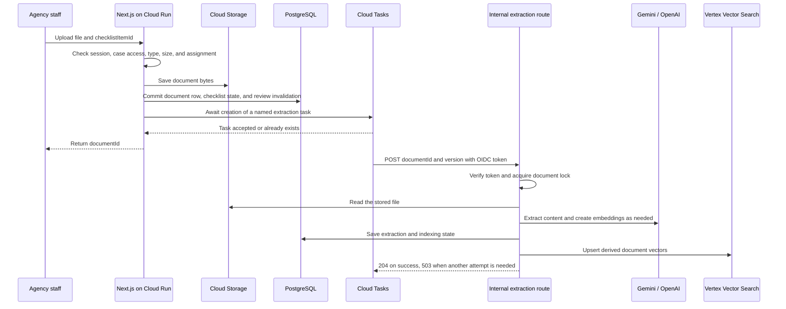
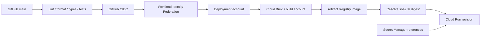

# Vidicy: technical reference

This reference is for engineers who maintain, deploy, or review the agency application. It assumes knowledge of HTTP, Node.js, SQL, and cloud service accounts. Use the [main README](../../README.md) for the product workflow and runtime configuration.

## How to read this reference

Each section connects a service to its role, code, operating contract, and limits. **Implemented** describes source behavior. **Observed** describes service configuration that must be verified before an operating decision. **Recommended** identifies an operating practice to assess or implement. The design notes explain technical consequences.

## Contents

- [System boundaries](#system-boundaries)
- [Observed deployment profile](#observed-deployment-profile)
- [Cloud Run](#cloud-run)
- [Cloud SQL for PostgreSQL](#cloud-sql-for-postgresql)
- [Cloud Storage](#cloud-storage)
- [Memorystore for Redis](#memorystore-for-redis)
- [Cloud Tasks and Cloud Scheduler](#cloud-tasks-and-cloud-scheduler)
- [Gemini on Vertex AI](#gemini-on-vertex-ai)
- [Vertex AI Vector Search](#vertex-ai-vector-search)
- [Identity, IAM, and secrets](#identity-iam-and-secrets)
- [Build, release, and rollback](#build-release-and-rollback)
- [Monitoring and service objectives](#monitoring-and-service-objectives)
- [Recovery procedures](#recovery-procedures)
- [Data location and retention](#data-location-and-retention)
- [Capacity and cost controls](#capacity-and-cost-controls)
- [Configuration and code map](#configuration-and-code-map)
- [Current limits and follow-up work](#current-limits-and-follow-up-work)

## Terms used here

| Term | Meaning |
| --- | --- |
| ADC | Application Default Credentials: how the cloud client libraries obtain their configured identity |
| IAM | Identity and Access Management: policies that grant access to cloud resources |
| OIDC | OpenID Connect: the signed identity-token format used for machine calls here |
| VPC | Virtual Private Cloud: the network path for configured private resources |
| TTL | Time to live: when a Redis value expires |
| PITR | Point-in-time recovery: database recovery to a supported earlier time |
| CRC32C | A checksum used to detect transfer corruption |

## System boundaries

One Next.js service handles the web interface, server actions, document APIs, and internal processing routes. PostgreSQL and Cloud Storage hold authoritative case data and document bytes.

| Information | Authoritative store | Derived or temporary representation |
| --- | --- | --- |
| Cases, applicants, checklist assignments, findings, and report state | PostgreSQL | Page models and cached counts |
| Uploaded document bytes | Cloud Storage | Parsed text and rendered page images |
| Extracted text and processing state | PostgreSQL | Embeddings and retrieved snippets |
| Searchable document chunks | PostgreSQL text is the source; the search index is derived | Vertex vectors and Cloud Storage metadata objects |
| Sessions, auth tokens, rate-limit counters, and caches | Redis for the active value | Cookies contain session references |
| Work delivery | Cloud Tasks for queued work; PostgreSQL for document progress | Scheduler identifies work that needs recovery |

A PostgreSQL transaction cannot commit a Cloud Storage write or a Cloud Tasks request. The upload path therefore has explicit partial-failure states.



The arrows summarize the successful path. Extraction and indexing update their own status fields at several points. They are not one distributed transaction. The [upload handler](src/app/api/_utils/document-upload.ts) and [pipeline](src/services/document-pipeline.ts) define the exact order.

### HTTP interfaces

| Route | Caller contract | Result |
| --- | --- | --- |
| `POST /api/documents/upload/pdf` | App session and case permission; multipart `file`, `applicationId`, `checklistItemId`; optional `applicantId` must match the case/requirement | Accepted upload returns `documentId`, name, and size after enqueue acceptance |
| `POST /api/documents/upload/image` | Same ownership contract; JPEG or PNG file | Same accepted-upload shape |
| `GET /api/document-preview/[documentId]` | App session and case permission; optional `download=1` | Authorized byte stream or missing/denied response |
| `POST /api/internal/document-extraction` | Verified machine OIDC token; JSON `{ documentId, version }` | 204 when this attempt is complete or obsolete; retryable processing failures use 503 |
| `POST /api/internal/document-reconciliation` | Verified machine OIDC token; no document payload required | Recovery/cleanup summary; 503 on recorded work failures |
| `GET /api/health` | Admin session | Component status and latency; can perform a Redis canary write |

The upload handler uses 400 for invalid input and 503 for explicit storage failure. An unexpected failure, including an enqueue failure after SQL commit, reaches its generic 500 response. Authentication and authorization helpers can reject a request before these operations. The task worker has a separate status contract described below.

### Design choices and consequences

| Implemented choice | Technical effect | Consequence to account for |
| --- | --- | --- |
| Web and task routes share one Cloud Run service | Reuses application code, service configuration, and database access | Processing and interactive requests share instance capacity |
| Queue work before returning upload success | Avoids acknowledging a job that was only scheduled in process memory | Queue failure can occur after the file and database row exist |
| Use PostgreSQL as the document authority | Search results can be checked against current case and document state | Retrieval requires database access as well as a healthy vector endpoint |
| Use named tasks, document locks, and stored results | Reduces duplicate processing during retries | External calls can still repeat across crash or acknowledgement boundaries |
| Deploy by container digest | Selects an exact image artifact | It does not prove vulnerability policy, provenance verification, or schema compatibility |

## Observed deployment profile

This profile describes observed service configuration. It is not a source-managed infrastructure definition or a live configuration report. Verify the settings before a capacity or availability decision.

| Resource | Observed configuration | Meaning |
| --- | --- | --- |
| Cloud Run | `asia-southeast1`; second-generation runtime; 2 vCPUs; 2 GiB; port 8080 | One regional application service |
| Cloud Run request limits | Concurrency 8; request timeout 1,800 seconds; revision maximum 3 instances | Configured request capacity, not a user-count or throughput benchmark |
| Network | VPC access configured; egress `private-ranges-only` | Private destinations use the VPC route |
| Public entry | Ingress `all`; platform invoker IAM check disabled | User routes rely on app authentication; internal routes require verified OIDC tokens |
| Cloud SQL | PostgreSQL 16; `db-custom-1-3840`; zonal | Zonal configuration does not provide a regional HA standby |
| SQL backup configuration | Automated backups enabled; retention configured for 7 backups | Verify PITR enablement and restore performance separately |
| Redis | Redis 7.2; Basic tier; 1 GiB; direct peering; AUTH enabled | Redis has a single primary in this tier; transport encryption was disabled |
| Cloud Storage | Regional Standard storage; uniform bucket access; public access prevention enforced | Document access is through application authorization and service credentials |
| Storage recovery | Soft delete retention 604,800 seconds, or 7 days | Logical deletion can precede physical expiry |
| Cloud Tasks | 2 dispatches/second; 3 concurrent dispatches; `maxAttempts=5`; backoff 10–300 seconds | Queue dispatch and retry settings are separate from application recovery claims |
| Cloud Scheduler | Every 5 minutes, UTC; enabled; OIDC configured | Calls the reconciliation route |
| Secret injection | Numbered Secret Manager versions referenced by environment variables | Rotation requires an explicit configuration/revision process |
| Identities | Runtime and document-task caller use the same service account | These are separate roles in the flow, but not separate accounts in this profile |

The repository's image-only deployment preserves these service settings. It does not recreate them. No availability percentage, latency target, recovery time, or supported agency count follows from this table.

### Read-only configuration inspection

These examples read configuration; they do not provision or update services. Replace the project, region, service, and queue when inspecting another environment. They select configuration/status fields and do not request secret payloads.

```bash
gcloud run services describe vidicy-agency \
  --project=eco-azimuth-441108-s4 \
  --region=asia-southeast1 \
  --format='yaml(status.latestReadyRevisionName,status.traffic)'

gcloud tasks queues describe vidicy-document-extraction \
  --project=eco-azimuth-441108-s4 \
  --location=asia-southeast1 \
  --format='yaml(state,rateLimits,retryConfig)'

gcloud scheduler jobs list \
  --project=eco-azimuth-441108-s4 \
  --location=asia-southeast1 \
  --format='table(name,schedule,timeZone,state)'

gcloud sql instances list \
  --project=eco-azimuth-441108-s4 \
  --format='table(name,region,databaseVersion,settings.tier,settings.availabilityType)'
```

Full service configuration can contain literal environment values. Use selected fields or a redacted configuration export for shared operational records. A cloud configuration read verifies the returned settings; it does not verify the affected user journey.

## Cloud Run

### Container and request lifecycle

**Implemented:** [Dockerfile](Dockerfile) uses Node.js 22 on Debian Bookworm. It installs pnpm 10.27.0, builds Next.js standalone output, and runs `apps/agency/server.js` as the `node` user. The server listens on `0.0.0.0` and port 8080. The [container runtime contract](https://docs.cloud.google.com/run/docs/container-contract) defines port, request, and file-system requirements.

[Next.js configuration](next.config.ts) includes the task SDK protocol files and native canvas dependencies in standalone tracing. These files are needed for task delivery and PDF page rendering.

`getRuntimeContext()` provides access to the cloud service adapters. Its `ctx.waitUntil()` uses Next.js `after()` for short follow-up work. Document extraction uses Cloud Tasks so it has a durable delivery record. See [runtime-context.ts](src/infra/runtime-context.ts).

Cloud Run request timeout, Cloud Tasks dispatch deadline, and per-model timeout are different settings. A route's `maxDuration` export does not configure the deployed Cloud Run service. The observed service timeout and extraction task deadline are both 1,800 seconds; model calls have shorter deadlines.

### Concurrency and network access

Concurrency is the number of requests an instance can serve at once. It is not the number of active users. PDF rendering, buffered uploads, SQL connections, and model requests compete for the same resources.

Private Redis connectivity needs the configured VPC route. The [Direct VPC egress guide](https://docs.cloud.google.com/run/docs/configuring/vpc-direct-vpc) explains the network, subnet, and egress controls. Verify network attachments in the service configuration; the image release does not provision them. External OpenAI, Perplexity, Resend, and Turnstile calls also need outbound connectivity.

## Cloud SQL for PostgreSQL

**Implemented:** [db/index.ts](src/db/index.ts) creates one shared `pg.Pool` for ordinary database work per Node.js process. It accepts `DATABASE_URL` or the standard `PG*` variables. `PGPOOL_MAX` defaults to 5; the observed deployment sets it to 8. The pool waits up to 10 seconds for a connection and releases idle connections after 30 seconds.

The production schema is [db/schema](src/db/schema/index.ts). Drizzle uses the PostgreSQL driver. JSON, timestamp, nullable-join, and `RETURNING` behavior stays in the driver.

### Transactions and locks

`db.withTransaction()` checks out one connection, runs `BEGIN`, executes the supplied callback, and commits or rolls back the group. `db.batch()` uses the same transaction helper for a list of Drizzle queries. `AsyncLocalStorage` routes queries from both paths, including queries in called helpers, to the checked-out connection. Nested transactions are rejected. Keep network and AI calls outside these transactions.

The [case creation action](src/actions/agency-case.action.ts) resolves or creates the client, inserts the case, and inserts its primary applicant in one transaction. If a required write fails, client changes and both inserts roll back. This transaction does not include storage, queue creation, or model calls.

The upload transaction creates the document row, updates its checklist item, and invalidates review state together. Review synchronization also checks document snapshots before accepting findings.

For existing review issues, [agency-review.ts](src/server/agency-review.ts) conditions updates and automatic resolution on the saved `updateCounter`, status, and `resolvedAt` values. An update is skipped if one of these values changed since the read. This protects a newer reviewer decision from that stale synchronization attempt. Changed evidence can still reopen an issue through the normal review rules.

The extraction route uses a **separate pool of 3 connections** for session-level PostgreSQL advisory locks. A lock identifies one document. Model inference does not hold a SQL transaction open. The connection remains checked out until the attempt ends. If lock release fails, the connection is discarded.

### Connection budget

A useful planning estimate is:

```text
ordinary application connections ~= active instances × (main pool + lock pool)
observed single-revision estimate = 3 × (8 + 3) = 33
```

This is a planning estimate, not a hard ceiling. Allow for overlapping revisions, migrations, administrator connections, and brief scaling overshoot. See the guidance on [Cloud Run SQL connections](https://docs.cloud.google.com/sql/docs/postgres/connect-run), [connection management](https://docs.cloud.google.com/sql/docs/postgres/manage-connections), and [maximum-instance behavior](https://docs.cloud.google.com/run/docs/configuring/max-instances).

### Schema release contract

[drizzle.config.ts](drizzle.config.ts) defines PostgreSQL schema generation. `pnpm db:generate <name>` generates a named migration. `pnpm db:migrate` applies the schema to the configured PostgreSQL database.

The release workflow does not migrate the database. Review and apply schema changes separately. Use compatible schema changes when old and new revisions can serve traffic at the same time.

## Cloud Storage

**Implemented:** [storage.ts](src/infra/google/storage.ts) uses `@google-cloud/storage` and Application Default Credentials. It provides the object operations used by existing callers: `get`, `head`, `put`, `delete`, and paginated `list`.

- Writes buffer the input, use `resumable: false`, and validate transfer integrity with CRC32C.
- HTTP metadata and custom metadata are preserved through the adapter.
- Reads first fetch metadata, then pin the byte stream to that object's generation. This avoids combining one generation's metadata with another generation's bytes.
- A missing object becomes `null`. Deletes ignore a missing object.
- List requests are paginated and limited to 1–1,000 entries.

See the service contracts for [object consistency](https://docs.cloud.google.com/storage/docs/consistency) and [request preconditions](https://docs.cloud.google.com/storage/docs/request-preconditions). The adapter's generation-pinned read is not a conditional-write guarantee: `put()` does not expose generation-match preconditions, multipart upload, or range reads.

### Upload and preview contract

The document routes accept PDF, JPEG, and PNG uploads. The file limit is 10 MiB. The PDF limit is 40 pages when the upload page-count check can determine a count. A parse failure in that preliminary check does not prove that a PDF is valid or within the page limit; processing has further handling.

Each upload must name a checklist item in the same case. The server checks applicant and checklist ownership before saving the file. Preview checks the active session and case permission, then streams the object through `/api/document-preview/[documentId]`. This path does not issue a public object URL. Its response permits private browser caching for one hour.

Object creation, SQL commit, and queue creation are separate operations. A failure after object creation but before SQL insertion can leave an unreferenced object. The document reconciler searches database rows; it is not an object-orphan collector. See the [upload handler](src/app/api/_utils/document-upload.ts) and [preview route](src/app/api/document-preview/[documentId]/route.ts).

### Support screenshot deletion

[support-attachments.ts](src/server/support-attachments.ts) provides shared cleanup for ticket and account deletion. Cleanup runs after the associated support rows have been removed. Before deleting an object, it checks the user's screenshot prefix or the admin screenshot prefix, verifies that the object's `uploadedBy` metadata matches the stored author, and checks for remaining ticket or message references. A stored key alone is not proof of ownership.

Account cleanup also collects attachments from messages that the user wrote on other users' tickets. Objects with remaining references, including shared admin screenshots, are retained. Cleanup errors produce a warning and can leave unreferenced objects. The reference check and object deletion are separate operations; they do not form an atomic transaction with concurrent attachment changes.

## Memorystore for Redis

**Implemented:** [kv.ts](src/infra/google/kv.ts) adapts the required KV operations to a shared Redis connection. Runtime prefixes separate application data (`vidicy:app:`) from session/cache data (`vidicy:cache:`). These prefixes are key namespaces, not separate tenant authorization boundaries.

| KV operation | Redis behavior |
| --- | --- |
| `get` | `GET`, with optional JSON decoding |
| `take` | `GETDEL`: return and remove a value in one operation |
| `increment` | Lua script with `INCR` and `EXPIRE` in one operation; renew the TTL |
| `incrementWindow` | Lua script that increments a counter, sets its initial TTL, and returns the count and remaining TTL without extending an active window |
| `put` with relative expiry | `SET ... EX` |
| `put` with absolute expiry | `SET ... EXAT` |
| Expiry already reached | Delete the key |
| `delete` | `DEL` |
| `list` | `SCAN` with prefix filtering and an opaque cursor |

The list cursor retains excess results because Redis `COUNT` is a hint. It is not a snapshot of keys during concurrent writes. Sessions use the cache namespace through `kv-session.ts`.

Connection setup has a 10-second timeout, bounded reconnect backoff, and an offline command queue that is disabled. Redis loss can therefore affect sign-in, token validation, rate limits, and cached reads. The app cannot treat Redis as an optional performance layer.

The observed Basic tier is a single primary. The [Redis tier explanation](https://docs.cloud.google.com/memorystore/docs/redis/faq) and [HA guide](https://docs.cloud.google.com/memorystore/docs/redis/high-availability-for-memorystore-for-redis) distinguish availability from durability; even replicated Redis can lose acknowledged writes during failover.

### Rate-limit windows and failures

[rate-limit.ts](src/infra/rate-limit.ts) uses `increment()` with a key for the configured clock-aligned window. The returned count determines whether the request is allowed. The key expires at the window boundary. Concurrent requests use the same atomic counter. Redis errors propagate to the caller; [with-rate-limit.ts](src/infra/with-rate-limit.ts) does not continue to the protected action after a counter error.

[action-rate-limit.ts](src/infra/action-rate-limit.ts) uses `incrementWindow()` for a per-user, per-action window. Its one-hour window starts with the first request. Later requests do not extend the window, and crossing a clock-hour boundary does not reset it. The versioned `rl:v2:` keys avoid the older JSON counter format. An exceeded limit raises `TOO_MANY_REQUESTS`. A Redis error is logged and the action is allowed to continue. Atomic counters therefore do not provide a hard action limit during a Redis outage.

### Single-use password reset tokens

The [reset action](src/app/(auth)/reset-password/reset-password.action.ts) uses `take()` before the password write. Only one concurrent request can receive the token value. The action then checks the stored token state and expiry, updates the password, and invalidates the user's sessions.

Token consumption, the SQL password update, and Redis session deletion are separate operations. If a later password or session operation fails, the token remains consumed. The user must request a new reset link before another attempt.

## Cloud Tasks and Cloud Scheduler

### Delivery contract

Cloud Tasks can redeliver work and does not promise FIFO execution. See [Cloud Tasks issues and limitations](https://docs.cloud.google.com/tasks/docs/common-pitfalls). Handlers must tolerate repeated work.

[document-tasks.ts](src/infra/google/document-tasks.ts) creates a named HTTP task in `vidicy-document-extraction`:

```text
name suffix = SHA-256(JSON.stringify({ documentId, version }))
body        = { documentId, version }
target      = DOCUMENT_TASK_BASE_URL + /api/internal/document-extraction
audience    = DOCUMENT_TASK_BASE_URL origin
deadline    = 1,800 seconds
```

The default version is `initial`. An existing task name is treated as an accepted enqueue. This deduplication is bounded by the queue's task-name retention behavior; it is not a permanent job ledger.

The upload handler awaits queue creation before returning success. A queue error after SQL commit returns an error to the client while the queued document row remains available for reconciliation. The implementation does not use a transactional outbox table.

### Worker responses

The [extraction route](src/app/api/internal/document-extraction/route.ts) verifies identity before reading its bounded 4,096-byte JSON body. It acquires the document's advisory lock, checks that the document still exists, then runs extraction and indexing.

| Condition | Response | Delivery meaning |
| --- | --- | --- |
| Missing or invalid identity token | 401 | Caller has not established identity |
| Valid token from the wrong verified account | 403 | Caller is not permitted |
| Invalid payload | 400 | Payload is not usable |
| Document has been deleted | 204 | Acknowledge obsolete work |
| Extraction and indexing succeed | 204 | Acknowledge this attempt |
| Lock is held, processing fails, or a dependency is unavailable | 503 | Another attempt is needed |

The pipeline reuses stored extraction or a completed index when its state permits. An empty or failed extraction result can update the document only if the database still has no nonblank text. A late failed attempt therefore cannot erase text saved by a successful attempt. After a failed extraction attempt, `ensureDocumentExtraction()` reloads the row and returns stored text when another attempt has saved it. See [document-pipeline.ts](src/services/document-pipeline.ts).

A crash after an external model or index call but before recording its result can still cause repeated calls. These safeguards protect stored results; they do not provide exactly-once model execution.

HTTP target tokens, task service accounts, and retry behavior are described in the [HTTP task guide](https://docs.cloud.google.com/tasks/docs/creating-http-target-tasks) and [queue configuration guide](https://docs.cloud.google.com/tasks/docs/configuring-queues). Retry delivery, SDK request retries, and application recovery are three separate mechanisms.

### Bounded reconciliation

The [reconciliation route](src/app/api/internal/document-reconciliation/route.ts) is a scheduled repair path. It checks:

- Uploads still queued after 2 minutes.
- Extraction that is failed or still extracting after 10 minutes.
- Completed or partial extraction with indexing queued after 2 minutes.
- Failed or active indexing that has remained old for 10 minutes.

It excludes trashed cases, selects up to 30 documents, and enqueues in groups of 3. A database update reserves a recovery attempt atomically. Each document has up to 3 recovery claims and at most one claim per 15-minute bucket. A changing sort order reduces the chance that old failing records block newer records.

Recovery task versions include the time bucket. Three recovery claims do not mean three total model calls: a claimed task can have its own delivery attempts. Claim reservation can also be consumed by an enqueue failure. After the claim limit, an operator must investigate.

The same route processes bounded vector metadata cleanup. It returns 503 if enqueue or cleanup work fails. The observed Scheduler runs every 5 minutes; the [Scheduler delivery contract](https://docs.cloud.google.com/scheduler/docs/overview) also allows duplicate invocation.

## Gemini on Vertex AI

**Implemented:** [gemini.ts](src/lib/gemini.ts) creates a `GoogleGenAI` client with `vertexai: true`, a project, and a location. Location defaults to `global`. ADC is the normal identity source. The optional JSON credential override is used by this client only.

| Path | Model constant | Input and output contract |
| --- | --- | --- |
| Extraction | `gemini-3.8-flash` | Inline PDF or image bytes and an extraction prompt; low thinking level; plain text |
| Evaluation | `gemini-4-argon` | Text and validated inline images; medium thinking level; JSON Schema output |

The [model catalog](https://docs.cloud.google.com/gemini-enterprise-agent-platform/models/google-models) and [release notes](https://ai.google.dev/gemini-api/docs/changelog) describe the model families. Project access, quota, supported location, and model lifecycle still need to be checked when changing a model ID. A public catalog entry does not verify a request from this deployment.

### Extraction and evaluation controls

[pdf-parser.ts](src/services/pdf-parser.ts) first tries native PDF text. Gemini is used when that path cannot extract content. The image path also tries Gemini. Each Gemini request has a 40-second client deadline and checks for empty output and an incomplete finish reason.

[gemini-evaluation.ts](src/lib/gemini-evaluation.ts) requests `application/json` with `responseJsonSchema`. It reserves up to 8,192 extra output tokens for thinking, with a total cap of 32,768. It rejects unsupported remote image URLs, empty output, incomplete generation, and invalid JSON. The evaluation action then applies its Zod schemas and transforms.

See the contracts for [structured output](https://docs.cloud.google.com/vertex-ai/generative-ai/docs/multimodal/control-generated-output) and the supported [JSON Schema fields](https://docs.cloud.google.com/java/docs/reference/google-cloud-vertexai/latest/com.google.cloud.vertexai.api.GenerationConfigOrBuilder). A valid response shape does not establish that a document finding is correct. Human review and application consistency checks remain necessary. Some runtime schema fields have fallback values, so parsing is not proof that all fields were supplied correctly.

Extraction can fall back to OpenAI when enabled. Evaluation phases remain on Vertex AI and do not switch providers on a Vertex error. OpenAI still provides checklist structuring, translation, embeddings, and document chat; Perplexity still provides checklist research. The main README lists the exact configured IDs. If PDF-level extraction fails, the pipeline can render pages and run the enabled OpenAI page-extraction fallback in page order.

### Queued extraction and synchronous review

Cloud Tasks runs document extraction and indexing. The [evaluation server action](src/actions/evaluation.action.ts) separately awaits the review phases during the action request. It does not enqueue those evaluation phases as document extraction tasks. Queue retry/reconciliation therefore does not make a failed interactive evaluation an automatically retried background review.

### Quality evidence

The repository has separate evaluation suites and datasets under `src/__tests__/eval`. Accuracy, recall, and review-time claims require measured results. A model change should have a versioned dataset, prompt/schema version, failure examples, and a recorded result before it is described as an improvement.

## Vertex AI Vector Search

**Implemented:** [vector-search.ts](src/infra/google/vector-search.ts) uses the index/index-endpoint API. It calls `upsertDatapoints`, `removeDatapoints`, and `findNeighbors` through the authenticated service request helper.

### Index contract

- Dense vectors must contain exactly 1,536 finite values.
- The configured index must use `COSINE_DISTANCE` and support streaming updates.
- Index and endpoint resource names must specify the same project and region.
- The deployed index ID and authenticated public endpoint domain are required.
- Writes use batches of up to 100 vectors; deletions use up to 1,000 IDs.
- Queries require an exact `applicationId` or `documentId` restriction and accept `topK` from 1 to 1,000.

The [streaming index guide](https://docs.cloud.google.com/vertex-ai/docs/vector-search/update-rebuild-index) explains that deployment updates are asynchronous. Its [filtering guide](https://docs.cloud.google.com/vertex-ai/docs/vector-search/filtering) explains categorical restrictions. An acknowledged mutation does not mean every serving replica already reflects it.

### Chunking and metadata

The [document pipeline](src/services/document-pipeline.ts) stores up to 50,000 characters of extracted text. Chunking targets 3,200 characters with 320 characters of overlap, using paragraph boundaries. A single long paragraph can exceed the target; this is not a hard per-chunk bound.

Embedding requests use OpenAI `text-embedding-3-small` in batches of up to 500 chunks, with a 25-second client deadline. A point ID is `${documentId}-${chunkIndex}`. Search metadata includes the case, document, chunk index, and up to 3,500 characters of chunk content.

Metadata above the adapter's 2,048-byte threshold is stored as a content-addressed JSON object in Cloud Storage. The vector retains identity fields and a pointer. A new metadata version does not overwrite text behind a previously indexed point. This preserves the metadata supplied to the adapter; it does not remove the pipeline's upstream text and snippet limits.

### Retrieval and deletion correctness

The adapter fetches full datapoint metadata and checks each candidate against PostgreSQL. It rejects a deleted document, a trashed case, mismatched application identity, or a point ID that does not match the document/chunk format. Metadata object paths must match the expected document prefix and content hash format.

[vectorize-query.ts](src/lib/vectorize-query.ts) first requests 6 document-scoped neighbors. If necessary, it requests 24 case-scoped neighbors and retains the requested document's chunks. Filtered or stale candidates can reduce the returned count; the adapter does not promise to return exactly `topK` results.

After a point deletion is accepted, a manifest defers metadata cleanup for at least 24 hours. The scheduled cleaner checks that source documents no longer exist, processes up to 2 manifests per call, and retains failed work for a later attempt. User-facing authorization depends on the live database checks, not on waiting for the cleanup window to expire.

## Identity, IAM, and secrets

### Four identity paths

| Identity path | How identity is established | Purpose and scope |
| --- | --- | --- |
| Agency user | Email/password or Google OAuth, followed by an app session | Application permissions control access to a case and its documents |
| GitHub deployment | GitHub OIDC token exchanged through Workload Identity Federation | Impersonates the deployment service account for build and release work |
| Running container | Attached Cloud Run service account through ADC | Calls Storage, Tasks, and Vertex APIs and accesses configured secrets |
| Task or Scheduler caller | Google-issued OIDC ID token | Must match the internal route's audience and verified account email |

An agency user's Google OAuth token is not the credential used to access the storage bucket or Vertex AI. The [service identity guide](https://docs.cloud.google.com/run/docs/securing/service-identity) explains deployment and runtime identities.

### GitHub trust boundary

The observed workload identity provider accepts GitHub tokens only when all three claims match:

```text
repository_id       = 1424743538
repository_owner_id = 111155827
ref                 = refs/heads/main
```

The issuer is `https://token.actions.githubusercontent.com`. The workflow also has a repository-ID guard. The job guard controls workflow execution; the provider condition controls the cloud credential exchange. Both must remain correct after repository moves or release-branch changes. See the [deployment federation guide](https://docs.cloud.google.com/iam/docs/workload-identity-federation-with-deployment-pipelines).

### Permission responsibilities

The following table is a responsibility map, not a complete export of current IAM grants. Review resource scope when provisioning or changing an identity.

| Identity | Capabilities it needs | Important boundary |
| --- | --- | --- |
| Deployment account | Submit builds, read the source-staging bucket, read image metadata, update the target Run service, and act as the configured build/runtime identities | Does not need unrestricted project ownership to perform these tasks |
| Build account | Read staged source, write the image repository, and write build logs | Build inputs must not contain runtime credentials or private exports |
| Runtime account | Read/write the document bucket, call the configured Vertex resources, enqueue document tasks, access selected secret versions, and connect to Cloud SQL | PostgreSQL login privileges and Redis AUTH are separate from service API IAM |
| Task caller | Establish the OIDC identity permitted by the internal-route verifier | The enqueuer needs permission to use this identity; the task delivery service must be able to issue its token |

The runtime and task-caller roles share one account in the observed deployment. Separate accounts would be an architecture change, not a setting documented as already present here.

### Internal endpoint authentication

[internal-auth.ts](src/infra/google/internal-auth.ts) verifies token signature and audience with Google's OAuth library, then requires `email_verified=true` and an exact account-email match. Task-name, queue-name, and Scheduler headers are not identity evidence.

`DOCUMENT_TASK_BASE_URL` accepts only an HTTPS `run.app` origin without a custom port, user information, query, fragment, or non-root path. The same origin is the task destination and OIDC audience.

The public Cloud Run ingress and disabled platform invoker check make the application verifier important. A route is not network-private merely because its path starts with `/api/internal/`.

### Secret Manager and build-time values

The observed service injects database, Redis, AI-provider, OAuth, email, Turnstile, and Sentry settings through numbered Secret Manager version references. Keep secret values out of documentation and configuration review output.

[Secret Manager integration for Cloud Run](https://docs.cloud.google.com/run/docs/configuring/services/secrets) resolves environment-backed secrets at instance startup; numbered versions make the selected value explicit. A rotation procedure must update the reference, deploy a revision, and verify affected flows. Updating only the image does not select a new secret version automatically.

`NEXT_PUBLIC_SITE_URL` and the Turnstile public site key are build arguments in `cloudbuild.yaml`. Next.js can compile public variables into client assets. A runtime environment change alone does not rebuild those assets. Private API keys belong in server-side secret configuration.

The shared REST adapter uses ADC with the `cloud-platform` scope. IAM grants still determine its access. `GOOGLE_APPLICATION_CREDENTIALS_JSON` is a Gemini-client override; it does not configure Storage, Tasks, or the shared REST adapter.

## Build, release, and rollback

### Current release path



The [workflow](../../.github/workflows/deploy.yml) is the release entry point. Before Google Cloud authentication or the container build, it requires `pnpm lint`, `pnpm format:check`, `pnpm typecheck`, and `pnpm test` to pass. It serializes agency production jobs with `cancel-in-progress: false`. The [Cloud Build configuration](cloudbuild.yaml) uses a dedicated build account, a 1,800-second build timeout, `CLOUD_LOGGING_ONLY`, and an `images` output for Artifact Registry. CI supplies `_IMAGE_TAG` from the commit SHA, resolves the published image digest, and updates Cloud Run with that digest.

The [deployment script](scripts/google-deploy.mjs) offers the same image build/update path for an operator. It validates the image tag and returned digest. `--build-only` publishes an image without updating Cloud Run.

The deploy step changes the image reference. It does not provision the database, bucket, queue, schedule, network, IAM policy, or runtime secrets. The workflow does not run database migrations, a load test, or a browser acceptance flow. The manual deployment script does not run the CI code checks or Vitest; run those checks before using it. Both paths run the Next.js build and its configured TypeScript check during the container build.

The [Cloud Build to Cloud Run guide](https://docs.cloud.google.com/build/docs/deploying-builds/deploy-cloud-run) and [Artifact Registry integration](https://docs.cloud.google.com/artifact-registry/docs/integrate-cloud-run) describe the service boundaries used here.

### Code checks and isolated tests

Run `pnpm lint`, `pnpm format:check`, `pnpm typecheck`, and `pnpm test` from the repository root before release. CI installs PostgreSQL and Redis test tools and runs the same commands. The format check covers application source; generated migration metadata is excluded to preserve migration artifacts.

The standard test suite includes unit tests, component event tests, route tests, and tests with real local PostgreSQL and Redis processes:

- [The PostgreSQL helper](src/__tests__/helpers/postgres.ts) needs `pg_config` on `PATH` and `initdb` and `pg_ctl` in its reported binary directory. It creates a temporary cluster with a private Unix socket and no TCP listener. Tests use explicit connection options and do not select an application database from environment variables. These tests cover case rollback, concurrent review updates, extraction results, and attachment references.
- [The Redis integration tests](src/__tests__/google-kv.integration.test.ts) need `redis-server` and `redis-cli` on `PATH`. They start a temporary Redis process on a private Unix socket with TCP disabled. They check concurrent counters, window expiry, and single token consumption. They do not connect to application Redis.

The suite also checks that failed deletion previews block confirmation, displayed users are available to CSV export, and server-action callbacks receive the expected data. The test counts change as coverage changes; use the output from the relevant run as release evidence.

`pnpm test` excludes `src/__tests__/eval/**`. Passing the standard suite does not establish AI accuracy, production capacity, or a successful browser user journey. Run the separate model evaluation suites when assessing model quality, and record browser or live-service checks separately.

### Source and supply-chain boundaries

The build source archive and container context use separate exclusion rules. Both must exclude private credentials and application data.

The pipeline selects a digest, but it does not have an explicit vulnerability-blocking step, Binary Authorization gate, or provenance-verification gate. Build provenance and SBOM availability are separate from enforcement. See [build provenance](https://docs.cloud.google.com/build/docs/securing-builds/generate-validate-build-provenance) and [build security insights](https://docs.cloud.google.com/build/docs/view-build-security-insights). These are extension points, not established deployment controls in this repository.

### Release evidence to retain

For a release, record the commit SHA, workflow run, Cloud Build ID, image digest, ready revision, traffic allocation, relevant schema version, and runtime/secret configuration change. A ready revision establishes platform readiness; it does not establish a successful sign-in, upload, extraction, evaluation, or report flow.

The current workflow has no automated canary analysis or application-level rollback decision. **Recommended:** complete the user journeys affected by a release, then retain the result with the release record.

### Rollback procedure

1. Select a previous revision with known-good application evidence.
2. Confirm that its code supports the current database schema and secret versions.
3. Route traffic to that revision using Cloud Run's revision controls.
4. Check traffic, user access, upload processing, and dependency health.
5. Record the incident and the configuration that served it.

See [revision rollback and traffic migration](https://docs.cloud.google.com/run/docs/rollouts-rollbacks-traffic-migration). Traffic rollback does not reverse database migrations, object writes, model calls, or completed task effects. Returning to an old image can require a separate data-recovery decision.

## Monitoring and service objectives

### What is present

- Cloud Build sends build logs to Cloud Logging.
- The production logger emits JSON through stdout/stderr. Most ordinary entries use `level`; alert entries also include `severity` and `alertCategory`.
- Sentry initializes for Node.js when `SENTRY_DSN` is set. Its configured trace sample rate is 0.05.
- The admin-only `/api/health` route queries PostgreSQL, writes/reads/deletes a Redis canary, and lists a storage object page. Each request uses a unique canary key and value. Deletion runs in `finally`; the key also has a 60-second TTL if cleanup fails. Concurrent checks do not share a key.
- Document rows hold extraction/indexing status and recovery counters.

The health route is an active dependency diagnostic. It returns 200 for healthy or degraded status and 503 only when all three checked components are down. It is not an unauthenticated startup probe, an end-to-end user check, or an availability SLI by itself.

The [Cloud Run logging guide](https://docs.cloud.google.com/run/docs/logging) documents JSON `severity` and `logging.googleapis.com/trace`. The current logger does not consistently emit the trace-correlation field. JSON logs alone do not establish complete request-to-task tracing.

### Recommended signals

Use [latency, traffic, errors, and saturation](https://sre.google/sre-book/monitoring-distributed-systems/) as core service signals. Apply them to actual agency journeys:

| Journey or resource | Signal to collect | Diagnostic use |
| --- | --- | --- |
| Sign-in and case access | Success ratio and successful/failed request latency | Separate auth configuration failures from infrastructure failures |
| Upload | Accepted requests, failures by stage, upload size, and latency | Detect storage, database, and enqueue failures |
| Processing | Queue wait plus processing time; age of queued work | Detect a stalled or under-provisioned pipeline |
| Model requests | Provider, model, status, latency, tokens, and retries | Distinguish quota errors from invalid input or provider failures |
| SQL | Active connections, pool wait, transaction errors, storage, CPU | Detect connection pressure and database limits |
| Redis | Memory, evictions, connections, command failures | Detect session loss and cache pressure |
| Vector search | Upsert/query errors, valid returned neighbors, and rejected stale candidates | Detect index drift and retrieval degradation |
| Recovery | Claim counts, exhausted documents, and cleanup backlog | Find work that needs operator action |

These are proposed monitoring requirements. This repository does not define a complete Cloud Monitoring dashboard, alert policy, or distributed trace pipeline for them.

### SLI and SLO definitions

A service-level indicator (SLI) measures a user-visible outcome. A service-level objective (SLO) sets its target and time window. The following are candidate definitions, not measured targets:

| Candidate SLI | Definition to implement | Decision still required |
| --- | --- | --- |
| Interactive availability | Successful eligible agency requests / all eligible agency requests | Routes, error classification, measurement point, target, and review window |
| Processing timeliness | Eligible accepted uploads that reach the required completed state within `T` / eligible accepted uploads | Meaning of partial/skipped results, `T`, target, and treatment of provider incidents |
| Review validity | Displayed current reviews whose snapshots match the latest assigned documents | Sampling/measurement method and treatment of stale reports |

For each SLO, record its owner, source query, scope, exclusions, target, window, rationale, error-budget action, and review schedule. The [example SLO document](https://sre.google/workbook/slo-document/) shows this structure. Do not substitute queue enqueue counts for completed document outcomes. Evaluation datasets and service configuration alone do not establish accuracy, latency, uptime, or throughput results.

## Recovery procedures

### Failure map

| Failure | Persisted state that can remain | Current recovery or next investigation |
| --- | --- | --- |
| Storage write fails | No document row from this upload | Fix storage access or availability; the client can retry |
| SQL commit fails after storage succeeds | An unreferenced storage object | Investigate the failed write and object ownership; no general orphan collector is established |
| Enqueue fails after SQL commit | A document row in queued state | Scheduler can reserve a recovery enqueue; inspect queue permissions and response errors |
| A task is delivered twice concurrently | One document plus competing attempts | Advisory lock allows one active attempt; another receives 503 |
| A process stops during model work | Old extraction/indexing state | Queue retry and later reconciliation can resume; an external call may repeat |
| A document is deleted before its task starts | Obsolete task | Worker returns 204 |
| Vector mutation succeeds before replicas catch up | Search results can lag | PostgreSQL existence/identity checks reject invalid candidates |
| Model quota or provider failure persists | Failed work and growing task age | Review quotas and provider errors; inspect bounded recovery claims |
| Redis is unavailable | Session/token operations can fail | Restore connectivity or the service; session data loss can require sign-in again |
| A new image fails | New and previous revisions may both exist | Use a schema-compatible revision rollback |

### Investigate a processing backlog

1. Identify a document by its ID, case, upload time, extraction status, indexing status, and recovery count. Do not paste its document content into operational logs.
2. Check queue state and current retry/dispatch settings. Check whether the Scheduler job is enabled and reaches the expected route.
3. Use the document ID to inspect route logs. Classify 401/403 as identity failures and 503 by lock, dependency, or processing failure.
4. Confirm the storage object and database row still refer to the same document. Check Vertex/model access and SQL/Redis connectivity.
5. If recovery claims are exhausted, resolve the cause before a reviewed requeue or correction. No production repair CLI or safe counter-reset procedure is established by this README.

The task's ID is a hash, not the plain document ID. Use task payload metadata with appropriate access. The reconciler's summary is not a ledger of completed documents.

### Backup and restore responsibilities

| Data | Recovery requirement | Established evidence |
| --- | --- | --- |
| PostgreSQL | Defined backup retention, tested restore, and an explicit PITR decision | Automated backups and a retention count of 7 observed; restore drills and recovery objectives require separate evidence |
| Storage objects | Restore the required bytes/generation and reconnect valid document references | Seven-day soft delete observed |
| Redis | Restore available data or expire sessions and rebuild derived state as appropriate | Basic tier observed; recovery behavior depends on what was lost |
| Vector index | Rebuild from authorized stored text/metadata and validate model dimensions and filters | Derived index adapter exists; an automated full rebuild/restore drill is not established |
| Runtime configuration | Recover identities, secret references, network attachments, queue, and schedule settings | Existing service configuration; no complete declarative environment definition in the repository |

The service guides distinguish [Cloud SQL HA](https://docs.cloud.google.com/sql/docs/postgres/high-availability), [backups and PITR](https://docs.cloud.google.com/sql/docs/postgres/backup-recovery/pitr), and [storage soft delete](https://docs.cloud.google.com/storage/docs/soft-delete). Backups are not an HA standby. Soft delete is not a complete cross-service restore plan.

**Recommended:** establish a recovery point objective (acceptable data loss) and recovery time objective (acceptable restoration time), then measure a restore drill. Neither value is claimed here. Check case references, report validity, vector filters, and pending jobs after a restore.

## Data location and retention

The observed application, SQL, Redis, and document bucket are in Singapore (`asia-southeast1`). The Gemini client defaults to the **global** endpoint. The [model location guide](https://docs.cloud.google.com/vertex-ai/generative-ai/docs/learn/locations) distinguishes endpoint choice from data-residency guarantees. A regional application service does not establish that all AI processing remains in that region.

| Destination | Data the current integration can send |
| --- | --- |
| Gemini through Vertex | PDF/image bytes for extraction; selected document text and inline images for evaluation |
| OpenAI | Extracted chunk text for embeddings; checklist inputs; evaluation translation; chat context; fallback document extraction when enabled |
| Perplexity | Checklist research inputs |
| Resend | Recipient addresses and email content |
| Sentry | Captured errors and attached application context |

The task and REST helpers avoid raw token and SDK-payload logging on their failure paths. The general application logger accepts metadata, and some older call sites pass error objects. Complete redaction, audit-event coverage, and downstream retention must be reviewed as separate controls. This document makes no compliance certification or zero-retention claim.

Case access checks, a deletion marker, vector removal, metadata cleanup, object soft delete, and backup expiry are different events. Document each retention period before promising an erasure timeline. Browser-private preview caching can also retain a previously delivered response until its cache lifetime ends.

## Capacity and cost controls

The important capacity boundaries are instance resources/concurrency, SQL pools, Redis memory, queue concurrency, model quotas, and the vector serving index. The observed queue allows 3 simultaneous dispatches across the queue. A configured 3-instance revision at concurrency 8 suggests 24 HTTP slots under ordinary conditions; it is not a benchmark of 24 users or 24 simultaneous extraction jobs.

| Driver | What to observe or control |
| --- | --- |
| Cloud Run | CPU/memory use, request duration, minimum instances, concurrency, and maximum instances |
| Cloud SQL | Instance size, connection budget, storage, backups, and HA choice |
| Redis | Provisioned memory/tier and eviction behavior |
| Vertex vector serving | Index size, deployed capacity, metadata fetches, mutations, and rebuilds |
| Gemini and other model calls | Tokens, image/page count, retries, fallback calls, and completed-result reuse |
| Cloud Storage | Stored source files, metadata versions, operations, soft-deleted bytes, and transfer |
| Build and observability | Image storage, build time, source archives, log retention, and trace volume |

The [cost optimization guidance](https://docs.cloud.google.com/architecture/framework/cost-optimization) connects these choices to workload demand. No cost-per-case estimate is established here. Model changes can affect quality, latency, and retry cost together; compare them on the same workload.

**Recommended:** record a cost baseline, set a budget/notification policy, and review cost per completed case and per processed page. Ordinary [alerts-only budgets](https://docs.cloud.google.com/billing/docs/how-to/budgets) notify; they do not themselves cap usage. Confirm the specific budget product and any enforcement before calling it a spend limit.

## Configuration and code map

### Configuration contracts

| Setting | Contract and consumer |
| --- | --- |
| `GOOGLE_CLOUD_PROJECT` | Project used by the Gemini client, storage client, and task queue path |
| `GOOGLE_CLOUD_LOCATION` | Generative model location; defaults to `global` |
| `GOOGLE_CLOUD_REGION` | Task region; defaults to `asia-southeast1`; does not relocate existing storage, SQL, or vector resources |
| `DATABASE_URL` or `PGHOST`, `PGPORT`, `PGDATABASE`, `PGUSER`, `PGPASSWORD` | PostgreSQL connection; production can use the attached Cloud SQL socket |
| `PGPOOL_MAX` | Main database pool limit; default 5 |
| `REDIS_URL` | Redis connection URL; secret reference in the observed service |
| `GCS_DOCUMENT_BUCKET` | Document and vector metadata bucket |
| `VERTEX_VECTOR_INDEX` | `projects/PROJECT/locations/REGION/indexes/NUMBER` |
| `VERTEX_VECTOR_INDEX_ENDPOINT` | Matching `projects/PROJECT/locations/REGION/indexEndpoints/NUMBER` |
| `VERTEX_VECTOR_DEPLOYED_INDEX_ID` | Deployed index identifier used in neighbor queries |
| `VERTEX_VECTOR_PUBLIC_ENDPOINT_DOMAIN` | Authenticated serving domain ending in `.vdb.vertexai.goog` |
| `GOOGLE_CLOUD_SERVICE_ACCOUNT` | Permitted task/Scheduler OIDC account email |
| `DOCUMENT_TASK_BASE_URL` | Canonical HTTPS `run.app` origin used as destination and audience |
| `NEXT_PUBLIC_SITE_URL` | Canonical app origin, OAuth callback prefix, and public build configuration |
| `GEMINI_DOCUMENT_EXTRACTION` | Set `false` or `0` to disable the Gemini extraction path |
| `OPENAI_DOCUMENT_EXTRACTION_FALLBACK` | Set `false` or `0` to disable OpenAI extraction fallback |
| `GOOGLE_APPLICATION_CREDENTIALS_JSON` | Optional Gemini-only credential override; ADC remains the shared cloud service adapter credential path |
| `SENTRY_DSN`, `DB_SQL_LOG`, `LOG_LEVEL` | Error reporting and diagnostic controls |

A queue, vector index, bucket, SQL instance, secret reference, and model entitlement must exist; an environment variable does not create any of them.

### Source entry points

| Concern | Source |
| --- | --- |
| Runtime service access | [runtime-context.ts](src/infra/runtime-context.ts) |
| ADC and bounded REST retries | [google/auth.ts](src/infra/google/auth.ts) |
| PostgreSQL and transactional batches | [db/index.ts](src/db/index.ts) |
| Object storage | [google/storage.ts](src/infra/google/storage.ts) |
| Redis namespace adapter | [google/kv.ts](src/infra/google/kv.ts) |
| Task creation and lock pool | [google/document-tasks.ts](src/infra/google/document-tasks.ts) |
| OIDC verifier | [google/internal-auth.ts](src/infra/google/internal-auth.ts) |
| Task worker | [document-extraction route](src/app/api/internal/document-extraction/route.ts) |
| Recovery and cleanup | [document-reconciliation route](src/app/api/internal/document-reconciliation/route.ts) |
| Vector adapter and cleanup | [google/vector-search.ts](src/infra/google/vector-search.ts) |
| PDF extraction | [pdf-parser.ts](src/services/pdf-parser.ts) |
| Model selection and evaluation | [gemini.ts](src/lib/gemini.ts), [gemini-evaluation.ts](src/lib/gemini-evaluation.ts) |
| Document state and embedding pipeline | [document-pipeline.ts](src/services/document-pipeline.ts) |
| Review snapshot validity and issue synchronization | [agency-review.ts](src/server/agency-review.ts) |
| Container and release | [Dockerfile](Dockerfile), [cloudbuild.yaml](cloudbuild.yaml), [workflow](../../.github/workflows/deploy.yml) |

### Commands from this directory

| Command | Effect |
| --- | --- |
| `pnpm dev` | Start Next.js on port 3002 |
| `pnpm build` | Build the application |
| `pnpm start` | Serve the production build; use `PORT` to select a port |
| `pnpm lint` | Run ESLint |
| `pnpm format:check` | Check source formatting with Prettier |
| `pnpm typecheck` | Generate Next.js route types and check TypeScript |
| `pnpm test` | Run the standard Vitest suite |
| `pnpm eval` | Run separate model evaluation suites |
| `pnpm db:generate <name>` | Generate a named PostgreSQL migration |
| `pnpm db:migrate` | Apply PostgreSQL migrations to the configured target |
| `pnpm email:dev` | Start the email preview server on port 3003 |
| `pnpm deploy` | Build and deploy to the configured cloud project |
| `pnpm deploy:google:build` | Build and publish the image without updating the service |

## Current limits and follow-up work

| Area | Current boundary | Evidence or next decision needed |
| --- | --- | --- |
| Infrastructure reproduction | Release scripts update an existing service | A complete versioned provisioning definition is not present |
| Regional availability | Zonal SQL and Basic Redis were observed | Make an explicit HA decision based on required user outcomes |
| Transport and secrets | Secret injection uses versioned references; observed Redis transport encryption is disabled | Review transport requirements and rotate through an explicit release procedure |
| Rate limiting | Counters are atomic; per-user action limits allow requests after Redis errors | Decide whether action limits must reject requests during Redis outages |
| Cross-service writes | No distributed transaction or transactional outbox | Account for object orphans, enqueue failures, and duplicate external effects |
| Processing recovery | Three bounded recovery claims plus queue retries | Define an operator-owned response after exhaustion |
| Observability | Logs, Sentry, and health diagnostics exist | SLOs, complete trace correlation, and checked-in alert/dashboard definitions are not established |
| Disaster recovery | Backup and soft-delete configuration observed | Verify PITR, define recovery objectives, and record restore drills |
| Release enforcement | Lint, format, type, and standard test gates precede a digest-based release | Canary analysis, vulnerability blocking, and attestation verification are not explicit release gates |
| AI quality and location | Schema checks and configured models exist; generative endpoint defaults global | Record evaluated quality and review processing-location requirements |
| Reports and reviewer controls | Report list/actions exist; the case toolbar is not mounted | Report export/delivery and toolbar reachability remain incomplete |

## Documentation maintenance

Review this reference when a cloud service adapter, schema, model ID, internal endpoint, deployment identity, or service setting changes. Verify source behavior and service configuration separately. Retain the distinction between code defaults, deployed settings, measured outcomes, and recommended work. Keep secret values and source documents out of documentation examples.
